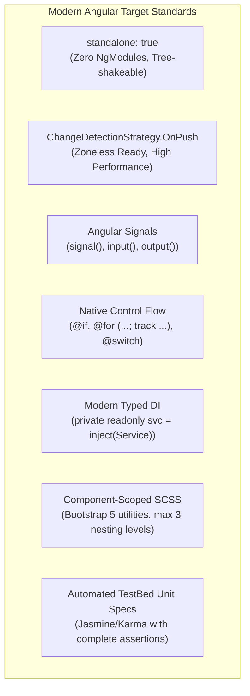
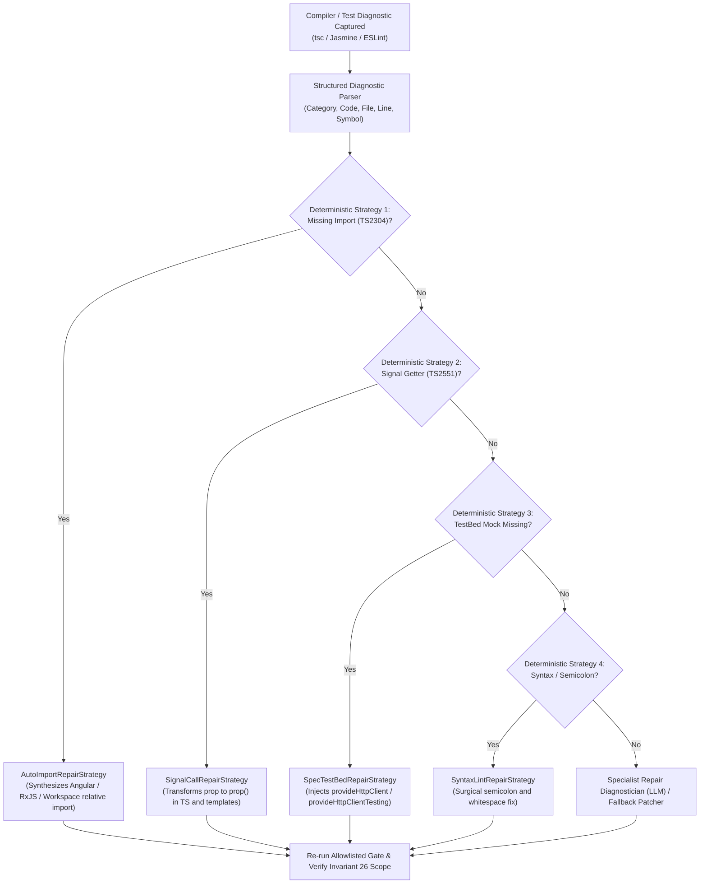
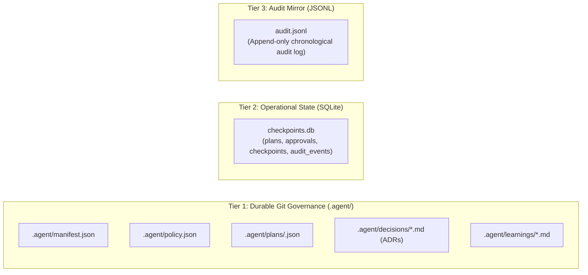

# Platform Capabilities & Specifications

The **Migration Agent** is an industrial-grade, safety-first migration platform engineered to autonomously discover, plan, transform, and validate legacy web codebases.

---

## 1. Supported Source Frameworks & Discovery Matrix

The platform deterministically detects source frameworks using weighted file, manifest, and syntax evidence:

| Framework | Detection Evidence | Extracted Capabilities | Target Frameworks |
|---|---|---|---|
| **Ember Classic** (v2.x – v3.x) | • `ember-source` / `ember-cli` in `package.json` • `ember-cli-build.js` • `app/components/*.js` • `app/templates/components/*.hbs` | • Component class properties & actions • Handlebars template arguments (`{{@prop}}`) • Local reactive state (`isExpanded: false`) • Component CSS styles | Modern Angular 17+ / 21+ Standalone |
| **AngularJS Directives** (v1.x) | • `angular` in `package.json` • `*.directive.js`, `*.component.js` • `.directive(...)` declarations • `*.template.html` with `ng-*` | • Isolated scope bindings (`@`, `=`, `<`) • Event callbacks (`&`) • Controller methods & injected services • Directives: `ng-if`, `ng-repeat`, `ng-click`, `ng-show` | Modern Angular 17+ / 21+ Standalone |
| **AngularJS Services & Factories** | • `*.service.js`, `*.factory.js` • `.service(...)`, `.factory(...)` declarations | • Public service methods • HTTP operations (`$http.get`, `$http.post`) • Injected application dependencies | Modern Angular `@Injectable({ providedIn: 'root' })` |
| **Full-Stack Multi-Layer Discovery** | • FastAPI / Flask Python routes • Express.js router endpoints • SQL DDL (`CREATE TABLE`, `FOREIGN KEY`) | • Cross-domain graph nodes (Frontend $\leftrightarrow$ Backend $\leftrightarrow$ Database) • HTTP invocation mapping • Table schema and foreign key relationships | Cross-Domain Architecture Graph |

---

## 2. Target Angular Architecture Standards

All code generated by the agent conforms to modern Angular standards (supporting Angular 17 through 21+):

### Generated Code Comparison:

| Feature | Legacy Source Pattern | Generated Modern Angular Pattern |
|---|---|---|
| **Component Decorator** | `Component.extend({ ... })` | `@Component({ standalone: true, changeDetection: ChangeDetectionStrategy.OnPush, ... })` |
| **Input Property** | `{{@title}}` or `scope: { title: '@' }` | `readonly title = input<string>('');` |
| **Output / Event** | `actions: { send() { ... } }` or `&` | `readonly send = output<any>();` |
| **Local State** | `this.set('isOpen', true)` | `readonly isOpen = signal<boolean>(false);` |
| **Template Condition** | `{{#if isOpen}}` or `ng-if="isOpen"` | `@if (isOpen()) { ... }` |
| **Template Loop** | `{{#each items as |item|}}` or `ng-repeat` | `@for (item of items(); track item.id) { ... }` |
| **Dependency Injection**| `controller: ['$http', 'UserSvc', function...]` | `private readonly userSvc = inject(UserSvc);` |
| **Styling** | `pull-right`, `col-xs-6` | `ms-auto`, `col-6`, modern Bootstrap 5 utility classes |

---

## 3. Actionable Diagnostic Self-Repair Engine

When generated code fails validation gates, the autonomous self-repair engine resolves issues in precedence order:

### Deterministic Repair Capabilities:
1. **`AutoImportRepairStrategy`**:
   - Catches missing symbols (`TS2304`, `TS2552`).
   - Maps standard symbols (`Component`, `signal`, `input`, `inject`, `HttpClient`, `Observable`) to their npm packages (`@angular/core`, `@angular/common/http`, `rxjs`).
   - Scans staging workspace files for project-internal service exports and computes relative POSIX import paths (`../../services/user.service`).
2. **`SignalCallRepairStrategy`**:
   - Catches uninvoked signal access (`TS2551`, `TS2339`).
   - Rewrites property access to getter function invocations (`this.name` $\to$ `this.name()`, `{{ name }}` $\to$ `{{ name() }}`).
3. **`SpecTestBedRepairStrategy`**:
   - Intercepts `NullInjectorError: No provider for HttpClient` in generated test specs.
   - Automatically injects `provideHttpClient()` and `provideHttpClientTesting()` into `TestBed.configureTestingModule`.
4. **`SyntaxLintRepairStrategy`**:
   - Resolves `TS1005: ';' expected` and trims trailing whitespace.

---

## 4. Operational Safety Invariants

The platform enforces **28 strict security invariants** to protect existing repositories from data loss, unintended mutations, or secret leaks:

| Invariant | Name | Guarantee |
|---|---|---|
| **Invariant 1** | Read-Only Source | Source repository is strictly read-only; no code modifications during inventory, analysis, or planning. |
| **Invariant 3** | Secret Exclusion | Secrets, tokens, credentials, and `.env` files are never read, indexed, staged, or logged. |
| **Invariant 4** | Symlink Containment | Reparse points, junctions, and symlinks resolving outside the repository root are ignored. |
| **Invariant 9** | Subprocess Allowlist | Shell commands are restricted to a static allowlist (`git`, `node`, `npm`, `npx`, `ng`, `tsc`, `pytest`). |
| **Invariant 10**| Shell Metacharacter Defense | Arguments containing `;`, `&&`, `\|`, `` ` ``, `$`, `\n` are rejected deterministically (`shell=False`). |
| **Invariant 11**| Secret Stripping in Child Procs| Sensitive environment variables (`*_KEY`, `*_SECRET`, `*_TOKEN`) are scrubbed before subprocess launch. |
| **Invariant 12**| Subprocess Resource Bounds | Subprocess execution is capped with timeouts (default 120s) and bounded outputs (64KB with SHA-256 digest). |
| **Invariant 16**| Curated Learning Promotion | Solutions cannot enter durable `.agent/learnings/` without explicit human operator approval ID. |
| **Invariant 25**| Clean Working Tree Guard | Mutations are rejected if the Git working tree has uncommitted modifications, preventing code clobbering. |
| **Invariant 26**| Bounded Repair Scope | Self-repair attempts have a strict attempt budget (default 3) and cannot touch files outside approved scope. |
| **Invariant 28**| Double-Fault Containment | If an apply rollback fails, the system transitions to `RECOVERY_REQUIRED` and halts automated writes. |

---

## 5. Storage Tiering Topology (ADR-1)

The platform separates durable governance from ephemeral operational state across three tiers:

- **RFC 8785 Canonical Serialization**: Metadata hashing uses deterministic JSON canonicalization. Plan approval signatures bind uniquely to the exact plan digest and policy digest; any post-approval tampering invalidates the approval token immediately.

## Phase 16 additions

The stdio surface now exposes fifteen typed tools: five inspection tools, six evidence/proposal/operation tools, and four stage/validate/review-request/apply tools. Request deduplication, generation leases, exclusive apply locks, immutable validation provenance, and single-use external approvals gate mutation. CLI review, approve, recover, and client setup are available. See [workflow guide](phase-16-client-setup.md).

Standalone `migrate` uses the configured provider and a bounded repair loop
through the same proposal/stage/validation gates. `submit-repair` supports external
typed proposals. Successful validation still requires separate human approval.
Semantic evaluation's `compilation_pass_rate` and `spec_pass_rate` remain structural
proxy metrics; passing immutable apply validation comes from actual command
execution in the configured isolated toolchain.

## Phase 16 native validation

| Mode | Code execution | Apply evidence |
|---|---|---|
| Restricted | None | None |
| Native | Human-authorized trusted account execution | Version 2 evidence plus separate exact approval |
| Container | Pinned local isolated image | Version 2 evidence plus separate exact approval |

Windows native validation supports fixed Node CLI templates, external offline
dependencies, bounded in-scope repair consent, revocation and atomic Job Object
supervision. It does not provide filesystem or network confinement. Linux uses
a separate guardian and has separate acceptance. [Operations](native-validation.md).

## Browser UI/UX validation

The shared production path now requires real browser capture and complete visual
review of a configured route/state/viewport matrix. Three added MCP tools expose
specialist instructions, captured PNGs and typed review submission (18 tools total).
Repair creates new artifacts and recaptures. Optional source reference comparison
and optional E2E-last are available. Direct provider image/code export remains
blocked pending authorization. [Operation guide](browser-ui-ux-validation.md).

## G1 rule registry and standards evidence

`agent validation standards` provides technical coverage/rule checks over
the shared staged-artifact workflow. It reports actual LF checks, reconciled
command evidence and pending semantic-review obligations using an opt-in profile.
Strict ingestion and digest/base/staging checks reject unsupported or stale inputs.
It does not execute commands, mutate source or authorize apply.
See [the scope and CLI guide](standards-review.md).

## Signed project access and user administration

Project writes now require current membership in an externally anchored signed
access revision. Owner CLI/API/GUI workflows manage finite roles, enrollment,
revocation and ownership. GitHub/GitLab imports use stable account/repository IDs;
provider roles do not grant agent authority. Human-only signing and current-worker
checks remain mandatory. See [operations and deployment boundaries](rbac-and-users.md).
