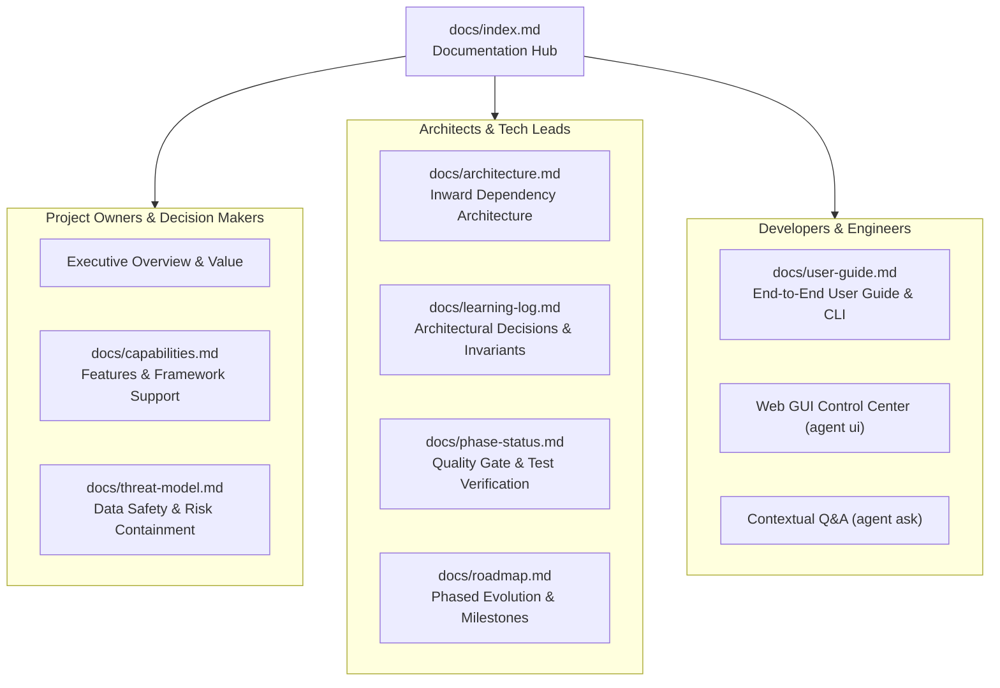

# Migration Agent Documentation Index

- [Project configuration and Settings](project-configuration.md): owners and eligible users,
  approved profiles, personal choices, checks, exact activation and recovery.
- [Configuration implementation evidence](../plannings/agent-configuration-management-implementation-report.md).

Welcome to the **Migration Agent Documentation**. This index is organized by stakeholder persona (**Project Owners**, **Architects & Tech Leads**, and **Developers & Engineers**) to help you quickly find the exact guides, technical references, and architectural specifications you need.

---

## 🧭 Navigation by Persona

---

## 1. For Project Owners & Decision Makers

If you are evaluating the platform, assessing risk, or managing migration timelines:

- **[Platform Capabilities & Matrix](capabilities.md)**:
  Comprehensive catalog of supported source frameworks (Ember.js, AngularJS), target architectures (modern Angular 17+ through 21+ Standalone), full-stack discovery (FastAPI, Flask, Express, SQL), and semantic evaluation metrics.
- **[Safety, Invariants & Zero-Risk Guarantees](threat-model.md)**:
  Detailed threat model and security invariants explaining why source code is treated as strictly read-only, how staging sandboxes prevent corruption, and how automated rollbacks guarantee zero data loss.
- **[Project Roadmap & Evolution](roadmap.md)**:
  The phased milestone history documenting the progression from core discovery to semantic transformation, diagnostic self-repair, and unified pipeline orchestration.

---

## 2. For Enterprise Architects & Technical Leads

If you are designing migration workflows, establishing governance, or auditing platform mechanics:

- **[System Architecture](architecture.md)**:
  Inward dependency architecture, ports and adapters (Hexagonal), 4-tier storage topology (Git `.agent/`, SQLite operational state, JSONL audit mirror), and cryptographic approval binding (RFC 8785 canonical digests).
- **[Architectural Decisions & Learning Log](learning-log.md)**:
  Chronological record of every architectural decision, security invariant (Invariants 1–28), and engineering lesson across all 15 implementation phases.
- **[Phase Verification & Quality Gates](phase-status.md)**:
  Detailed audit logs and test evidence for every phase, confirming 100% green compliance across 345+ unit, contract, and integration tests, strict mypy type checking, and ruff linting.
- **[ADR-8 Controlled Apply Protocol](architecture.md#staging-workspace--controlled-apply-protocol-adr-8)**:
  The formal 4-step apply protocol: worktree drift verification $\to$ preflight path containment $\to$ backup diff snapshots $\to$ atomic patch application $\to$ postcondition validation $\to$ verified rollback.

---

## 3. For Developers & Migration Engineers

If you are actively running migrations, reviewing diffs, or troubleshooting code:

- **[MCP inspection boundary and limits](phase-16a-remediation.md)** and **[host compatibility evidence](mcp-compatibility-spike.md)**: Phase 16A read tools, remediation, and pending primary-client verification.

- **[Complete User Guide & CLI Reference](user-guide.md)**:
  Step-by-step practical guide covering all CLI commands:
  - `agent doctor`: Local setup and dependency health check.
  - `agent inventory` / `agent adopt`: Discovery and Git-native `.agent/` scaffolding.
  - `agent preview` / `agent stage` / `agent apply`: Low-level surgical workflow.
  - `agent migrate`: Unified, end-to-end orchestrated pipeline.
  - `agent validate`: Running compiler, test, and linter gates.
  - `agent ask`: Contextual technical Q&A with citation verification.
  - `agent decision` / `agent learning`: Recording ADRs and promoting solutions.
  - `agent eval --semantic`: Running semantic benchmarks against synthetic fixtures.
- **[Local Control Center Web UI](user-guide.md#local-control-center-web-gui-agent-ui)**:
  How to launch and use the browser dashboard on loopback (`http://127.0.0.1:8080`) for project progress, evidence inspection and guarded workflow requests, with separate human-terminal approval.

---

## 📚 Master Document Catalog

| Document | Primary Audience | Description |
|---|---|---|
| **[index.md](index.md)** | All | Central documentation index and navigation map. |
| **[user-guide.md](user-guide.md)** | Developers, Engineers | Practical step-by-step guide, command reference, and workflows. |
| **[capabilities.md](capabilities.md)** | Owners, Architects | Full framework matrix, target standards, and self-repair capabilities. |
| **[architecture.md](architecture.md)** | Architects, Leads | Hexagonal architecture, ports/adapters, storage, and security protocols. |
| **[learning-log.md](learning-log.md)** | Architects, Developers | In-depth log of architectural decisions, invariants, and learnings. |
| **[phase-status.md](phase-status.md)** | Leads, Auditors | Implementation status, test suites, and quality gate evidence. |
| **[threat-model.md](threat-model.md)** | Security, Architects | Risk analysis, isolation boundaries, and fail-closed security invariants. |
| **[roadmap.md](roadmap.md)** | Owners, Leads | Project progression across Phases 0 through 15. |

## Phase 16 shared host workflow

See [client setup and operation](phase-16-client-setup.md), [workflow architecture](phase-16-host-workflow.md), and [smoke acceptance](phase-16-smoke-checklists.md). Host reasoning, staging, validation, exact human approval, and guarded apply use shared services. Historical Phase 16 limits are preserved; the subsequent common GUI is recorded separately below.

The [remaining implementation report](../plannings/phase-16-remaining-implementation-report.md)
records corrections, verification, and practical trust/isolation limits.

## Native validation amendment

- [Native validation operations and trust limits](native-validation.md)
- [Phase 16 implementation report](../plannings/phase-16-native-validation-implementation-report.md)

## Planned application UI/UX validation

The [browser UI/UX workflow amendment](../plannings/browser-ui-ux-validation-workflow-plan.md)
records mandatory AI browser review, responsive screenshots and repair, optional
source comparison, and optional E2E validation last. See [operations](browser-ui-ux-validation.md)
and the [implementation report](../plannings/browser-ui-ux-validation-implementation-report.md).
Host/CLI review and opt-in standalone OpenAI/Gemini visual review are implemented;
live acceptance is tracked separately.

## Common Control Center implementation

The [governed migration workflow](migration-workflow.md) is the current end-to-end
guide: owner setup, signed architecture, foundation, role handoffs, grounded
generation, validation, separate-target publication and recovery.

The [GUI operations guide](control-center.md) describes the canonical project
explorer, mobile drawer, evidence views and guarded action/terminal-review flow.
The [implementation report](../plannings/control-center-implementation-report.md)
records measured build/browser/backend verification and explicit product limits.

The [optional project-work definition](project-work.md) supplies typed Git-owned
foundation/module metadata linked to workflow evidence. The
[Angular development guide](../ui/control-center/README.md) covers structure,
local development and frontend quality gates.

The [manual GUI testing guide](manual-gui-testing.md) covers direct executable
launcher usage, new/existing projects, external state/staging roots, browser
sessions and the current wheel-versus-standalone package distinction.

The [standards review guide](standards-review.md) explains the opt-in G1 rule registry,
exact staged standards report and pending manual review obligations.

The [RBAC and user-management guide](rbac-and-users.md) covers signed owner bootstrap,
Git-member import, finite roles, identity enrollment, revocation and trusted Git
publication checks. [Implementation verification](../plannings/rbac-implementation-report.md)
distinguishes offline gates from actual owner/server deployment.
