# Agent Platform — Master Architecture Plan & Implementation Playbook

> **Document Type:** Authoritative Master Architecture & Implementation Specification  
> **Status:** Architecture Frozen & Reconciled — Active Source of Truth  
> **Scope:** Project-Neutral Agent Platform Core with Headless CLI, Decoupled Local GUI, 4-Tier Storage, and Pluggable Workflow/Migration Extensions  
> **Canonical CLI:** `agent` (backward-compatible alias: `migration-agent`)  

---

## 1. Core Vision & Scope

The platform provides a reusable foundation for agent-driven software engineering projects. The core platform remains strictly **project-neutral**. A new project initializes the platform and builds project-specific capabilities on top of it without modifying, forking, or refactoring the core.

The architecture strictly separates:
- **Core platform & execution engine:** Project-neutral orchestration, verification, policies, and persistence.
- **Project-specific configuration:** Settings declared in `.agent/config.json`.
- **Project-specific workflows & agents:** Pluggable migration, refactoring, or Q&A workflows.
- **Project-specific artifacts & documentation:** Generated specs, diffs, and Mermaid diagrams.
- **Generated code vs. Application business code:** Staged previewable patches vs. authoritative application code.
- **Local Control Center (GUI):** Standalone browser SPA consuming a typed Control API.
- **Target project runtime:** Target projects remain pure data; no platform runtime code is injected into them.

The reference migration pair (Ember Classic component to Angular Standalone component) is an extension workflow and proving fixture, never an assumption hardcoded into core application services.

---

## 2. Interactive and Self-Improving Agent

The agent platform is interactive, collaborative, and evidence-driven rather than an opaque code generator.

The platform enables agents to:
1. Understand current project state and inventory.
2. Understand architecture, decisions (ADRs), artifacts, and documentation.
3. Identify challenges/problems encountered during development or validation.
4. Record those challenges deterministically.
5. Propose candidate solutions and staged changes.
6. Verify solutions against allowlisted quality gates.
7. Capture proven solutions as curated learnings with full provenance.
8. Maintain traceability between Challenge $\to$ Analysis $\to$ Decision $\to$ Solution $\to$ Implementation $\to$ Artifact.

### Boundary of "Self-Improvement"
Autonomous self-modification of platform code or security policies is strictly prohibited (**Invariant 16**). "Self-improvement" is strictly bounded to the **curated project knowledge lifecycle**:
```text
Observed Diagnostic ──► Candidate Solution ──► Learning Candidate ──► Human Approved (Committed to Git)
```
Only learnings validated by passing test runs, verifiable diffs, and human review are promoted to `.agent/learnings/*.md`.

---

## 3. UI / Project Control Center

Every project initialized with the platform can launch a standalone, localhost web-based control center (`agent ui`):

```text
Project
├── Objectives & Requirements
├── Architecture
│   ├── Technical Architecture
│   ├── Functional Architecture
│   ├── Technology Stack
│   ├── Design Decisions (ADRs)
│   └── Source-Level Diagrams (Mermaid)
├── Workstreams & Tasks
│   ├── High-Level Steps
│   └── Low-Level Tasks
├── Progress & Run State
├── Agent Activity & Event Timeline
├── Challenges & Solutions
├── Curated Learnings
├── Side-by-Side Visual Diff & Approvals
├── Contextual Q&A
├── References & Documentation
└── Audit Trail & Event Stream
```

The GUI is a decoupled Single Page Application (SPA) served strictly on loopback (`127.0.0.1`), consuming the versioned Control API. It has zero direct access to the filesystem, Git, SQLite, or staging workspaces.

### GUI Technology Stack & Architectural Boundaries
- **Framework:** **Angular 21 LTS baseline**, Standalone APIs (`standalone: true`, `ChangeDetectionStrategy.OnPush`), with future upgrades to newer supported Angular majors only after compatibility validation.
- **Reactivity & Control Flow:** Angular Signals (`signal()`, `computed()`) and modern template syntax (`@if`, `@else`, `@for ... track`, `@switch`).
- **Styling:** **Bootstrap 5.3.x utility classes only** (`ms-*`/`me-*`/`ps-*`/`pe-*`, `d-flex gap-*`) with native dark mode support (`data-bs-theme="dark"`).
- **Behavioral Constraint:** **Bootstrap JavaScript plugins are not a required application interaction dependency.** Angular owns all application behavior and interaction state, including dialogs, navigation, menus, tabs, dropdowns, expand/collapse state, approvals, and WebSocket-driven state.
- **Component Libraries:** **No PrimeNG or third-party component library dependency is required or assumed in the baseline.** The Control Center depends on platform UI contracts and domain view models, keeping the UI layer lean and replaceable.
- **Diagrams & Security:** **Mermaid.js** text-driven diagram rendering. Repository-generated or agent-generated Mermaid content must be rendered using a restrictive Mermaid security configuration (`securityLevel: 'strict'`). Interactive/clickable behavior and embedded HTML are prohibited for untrusted diagram sources unless explicitly authorized by policy.
- **Client Transport & WebSocket Security:** Typed HTTP services and authenticated WebSocket client connected to the versioned Control API. Every WebSocket connection must authenticate during handshake using the per-launch session authentication model and must pass Origin validation (`http://127.0.0.1:<port>`). WebSocket messages remain strictly subject to core authorization and Policy Engine checks; the WebSocket channel never constitutes a policy bypass.

---

## 4. Project Knowledge & Artifacts (3-Tier Model)

Knowledge is partitioned into three distinct tiers (**ADR-3**):
1. **Tier 1 (Platform Knowledge):** Read-only architectural patterns, heuristics, AST templates, and troubleshooting catalogs shipped directly with the platform binary.
2. **Tier 2 (Project Knowledge):** Local, Git-versioned project learnings (`.agent/learnings/*.md`), architectural decisions (`.agent/decisions/*.md`), and challenges (`.agent/challenges/*.md`) backed by strict provenance and human curation.
3. **Tier 3 (Cross-Project Shared Knowledge):** Centralized global learning collection is explicitly deferred to later phases.

---

## 5. Architecture & Source-Level Diagrams

The platform visualizes technology stacks, component boundaries, agent workflows, and data flows using version-controlled text representations (**Mermaid**). Diagrams are generated into `docs/architecture/` with artifact ownership metadata (**ADR-9**):
- `Generated`: Machine-created from code analysis; regenerated automatically without prompts.
- `Human-Authored`: Created entirely by developers (manual ADRs); never overwritten by the platform.
- `Human-Modified Generated`: Machine-generated artifacts subsequently edited by humans. When regeneration occurs, the platform produces a visual diff and requires explicit human reconciliation.

---

## 6. Contextual Interaction (`ContextEnvelope`)

When interacting with the agent via CLI (`agent ask`) or GUI, interactions pass through a typed `ContextEnvelope` to prevent context bloat and hallucination:
```text
ContextEnvelope
├── project_ref / workspace_ref
├── selected_entity (Component, Task, Step, Decision, or Artifact)
├── selected_artifact (Specification, Diff, Report)
├── current_run (Active Run ID reference)
├── relevant_decisions (Linked ADR references)
├── relevant_learnings (Approved solution cards)
├── evidence_references (AST nodes, file paths, line ranges, diagnostic logs)
├── active_policy_version (Digest of current policy)
└── query (User prompt / instruction)
```

---

## 7. Project Lifecycle

1. **Scenario A — New Project (`agent init`):**
   - Initializes `.agent/` directory structure, platform manifest, default policies, role definitions, and local trust store.
   - Allows user and agent to collaboratively define requirements, architecture, and workstreams.
2. **Scenario B — Existing Project Adoption (`agent adopt PATH`):**
   - Strictly read-only inspection of target repository.
   - Deterministic discovery of technologies, package boundaries, and framework evidence.
   - Generates initial architecture documentation and project manifest without modifying target application code.
   - Requires working-tree cleanliness verification before any mutation can be staged or planned.

---

## 8. State Management & 4-Tier Storage Topology

The platform requires no cloud database, remote daemon, or container runtime for normal operation (**ADR-1**).

### The 4 Storage Tiers:
1. **Git (`.agent/`):** Durable project governance, version history, approved architectural decisions, policies, access roles, and curated learnings.
2. **SQLite (`checkpoints.db`):** Canonical local operational execution state, active run checkpoints, idempotency tracking, and event stream journal.
3. **JSONL (`audit.jsonl`):** Append-only audit and export representation for human inspection and external tool processing.
4. **Cryptographic Digests & Signatures:** Tamper-evidence mechanism for security-sensitive records (ChangeSets, approvals, policy definitions).

### Directory Layout:
```text
Target Project Root (Authoritative Git Repository)
├── .agent/
│   ├── manifest.json            # Project-neutral platform manifest
│   ├── config.json              # Active workflow configurations
│   ├── policy.json              # Operational safety rules & protected path globs
│   ├── access/                  # Git-native access control (Public data only)
│   │   ├── roles.json           # Role-to-capability mappings
│   │   └── principals.json      # Key fingerprints, role mappings, authority keys
│   ├── workflows/               # Security-sensitive workflow definitions (*.json)
│   ├── challenges/              # Recorded hurdle diagnostics (*.md)
│   ├── solutions/               # Staged & verified candidate solutions (*.md)
│   ├── learnings/               # Approved, human-curated learnings (*.md)
│   └── decisions/               # Recorded architectural decisions (*.md)
├── docs/
│   └── architecture/            # Generated Markdown & Mermaid diagrams
├── .gitignore                   # Must ignore local agent overrides (.agent/local/)
└── <Application Source Code>    # Untouched by platform runtime code

Local User-Data Directory (~/.agent-platform/ or OS User-Data)
├── trust/
│   └── <project-id>.json        # Bootstrapped trusted Authority Key fingerprints
├── state/
│   ├── checkpoints.db           # Authoritative SQLite event journal & run state
│   └── audit.jsonl              # Derived append-only event stream mirror
├── staging/
│   └── <run-id>/                # Isolated workspace for transformations & tests
├── cache/                       # AST, dependency, and search indexes
└── config/                      # User-specific preferences and GUI settings
```

---

## 9. User & Role-Based Access (Git-Native Capability Model)

The platform operates without a centralized authentication server (**ADR-2**).
- **Assurance Levels:**
  - **Mode A (Cryptographically Verified):** Actor identity anchored to a verified SSH/GPG signing key fingerprint. Required for policy updates, authority delegation, and production apply actions.
  - **Mode B (Local Trusted Session):** Single-user developer workstation session (OS account + local Git config). Permitted for local development, planning, and staging validation.
  - **Mode C (Unauthenticated / Inspection):** Read-only AST analysis and discovery; cannot stage mutations or execute privileged commands.
- **Identity vs. Signing Separation:** `IdentityPort` resolves actor identity; `SignaturePort` interfaces with SSH-agent/GPG for cryptographic signing.
- **Approval Signing vs. Git Commit Signing:** `ApprovalSignature` authorizes a specific ChangeSet digest; Git commit signing attests to a commit object; `committed_by` identifies platform attribution only.
- **Capability-Based Authorization:** Permissions are defined in `.agent/access/roles.json` as granular capabilities (`project.read`, `workflow.execute`, `changeset.stage`, `changeset.apply`, `policy.write`, `learning.approve`).
- **Anti-Self-Authorization:** Policies cannot self-authorize. Changes to roles, permissions, or security rules require an Authority Key signature bootstrapped into `~/.agent-platform/trust/<project-id>.json` bound to repository signals (root commit SHA and/or verified remote origin).

---

## 10. Architecture Invariants (The 40 Platform Rules)

These 40 invariants govern all platform behavior and must be upheld across all implementation phases:

1. **The LLM is an untrusted proposer.** Core domain logic must not rely on the model to enforce safety, validity, or correctness. Model outputs are untrusted inputs requiring deterministic validation.
2. **The core domain does not depend directly on an LLM provider (LLM Provider Neutrality).** Models are accessed strictly through `AgentRuntimePort` or equivalent domain interfaces. No core domain or application contract may depend on a specific model provider, SDK, or provider-specific orchestration framework. Provider integrations are infrastructure adapters behind `AgentRuntimePort`. The platform is provider-neutral, Gemini-default, and OpenAI-compatible by design. The default provider is configuration, not architecture.
3. **Proposal generation is read-only with respect to the authoritative target working tree.** Agent analysis and plan generation must never mutate the target project.
4. **Every proposed mutation is represented by a deterministic ChangeSet.** All file modifications, additions, and deletions are explicitly enumerated with canonical relative paths, file modes, and content digests computed over canonical byte representations (using SHA-256). Structured ChangeSet metadata is canonicalized via RFC 8785.
5. **Every approval is bound to the exact proposed ChangeSet digest.** Modifying a plan or ChangeSet invalidates the approval token and requires re-approval.
6. **Approved mutations are executed through controlled staging and validation.** Changes are applied first to an isolated staging workspace and tested against quality gates before touching the target working tree. Staging workspace operations and validation runs are policy-controlled and may execute autonomously for bounded self-repair loops.
7. **All privileged execution goes through explicit policy enforcement.** Commands, filesystem writes, and Git operations are evaluated by a centralized `PolicyEngine` before invocation. No unapproved agent-generated mutation reaches the authoritative target repository.
8. **Durable project knowledge has a defined source of truth.** All shareable project metadata, decisions, and approved learnings reside in Git-versioned project files.
9. **Runtime state is separated from Git-versioned project state.** Ephemeral execution state, checkpoints, caches, and indexes reside in local user-data storage and are never committed to Git.
10. **The GUI is a client of the platform Control API.** The GUI does not independently manipulate platform internals, filesystems, Git, or staging environments.
11. **Project-specific extensions use defined interfaces, workflow modules, configuration, or adapters.** Additive extensions are implemented through versioned contracts rather than modifying core domain logic.
12. **Observed, inferred, and human-confirmed project knowledge are distinguishable.** The platform explicitly tags epistemic status and provenance on all discovered and generated knowledge.
13. **Important agent actions generate traceable Run/Event records.** Every execution step, decision, command invocation, and approval is recorded in an append-only event stream.
14. **Secrets and sensitive payloads are governed by an event-data classification policy.** Event metadata is persisted; structured diagnostics are sanitized; raw command outputs are bounded and sanitized excerpts; raw environment variables and credentials are never persisted; full model/prompt contexts are omitted by default and referenced by digest.
15. **Platform version and project metadata/schema versions are explicitly tracked.** All persisted schemas (manifests, runs, learnings, decisions, access policies) declare explicit versioning.
16. **No autonomous self-modification of core platform behavior.** Agents cannot alter core code, platform configuration, or security policies without explicit human approval.
17. **The target project remains independently usable without requiring the Agent Platform runtime.** No runtime agent libraries or framework dependencies are injected into the target application.
18. **Platform removal must not destroy or invalidate the target project's application code.** Removing `.agent/` leaves the target project intact and functional.
19. **Authentication, authorization, and approval are distinct concepts.** Authentication verifies actor identity; Authorization checks capability against repository policy; Approval records a human sign-off on a specific ChangeSet digest.
20. **Application authorization is capability-based.** Core domain logic enforces granular capabilities (e.g. `changeset.apply`, `policy.write`) rather than hard-coded role names.
21. **Security policies cannot self-authorize.** Modifications to roles, permissions, or security configuration require authorization by a designated Authority Key or verified administrator signature.
22. **Every run maintains distinct actor attribution.** Audit records explicitly distinguish `requested_by` (human), `proposed_by` (agent), `approved_by` (human), and `committed_by` (agent Git identity).
23. **Client-side Git hooks are advisory guardrails, not the sole security authority.** The platform Policy Engine enforces security internally; client hooks prevent accidental mistakes; remote Git protections provide team-level enforcement.
24. **Trusted Authorization Bootstrap & Repository Binding Signals:** Authority Keys cannot derive trust solely from the repository files they authorize. Initial trust must be bootstrapped into an out-of-band local developer store (`~/.agent-platform/trust/<project-id>.json`). The trust record associates the Authority Key fingerprint with a stable repository binding signal (e.g. root commit hash or verified remote origin) to reduce accidental or malicious repository substitution. The trust store records the user's out-of-band trust decision rather than claiming universal cryptographic proof of repository ownership. Key rotation and revocation are managed locally without requiring a central server.
25. **Base-State Binding & Comprehensive Drift Invalidation:** Every ChangeSet is cryptographically bound to an exact base repository revision and working-tree state fingerprint. If the target repository drifts before apply, the run enters `BaseChanged`. Drift invalidates NOT ONLY approval, but ALSO staged output and validation results, requiring re-inspection and re-planning.
26. **Repair Loop Security Context:** Any automated self-repair that alters a ChangeSet creates a new distinct ChangeSet with a new canonical digest. It invalidates previous approvals and requires fresh policy evaluation and human sign-off where mandated.
27. **Authoritative Operational Store vs. Tamper Evidence:** SQLite is the canonical operational execution state and checkpoint journal; JSONL is an append-only audit export mirror. Neither is inherently tamper-proof against the workstation owner; tamper-evidence for security records relies on cryptographic digests, signatures, and hash chains.
28. **Transaction-Like Controlled Apply, Policy Re-Evaluation & Non-Universal Rollback:** Before final apply, the platform revalidates the complete security chain: ChangeSet digest, base revision, worktree fingerprint, active policy rule re-evaluation, approval signature verification, and staged output correspondence. Apply executes a controlled preflight, backup diff generation, patch application, and postcondition verification. On failure, rollback is attempted and verified; if rollback is partial or uncertain, the run transitions explicitly to `RecoveryRequired`. The platform must never silently assume rollback succeeded.
29. **Explicit Authentication Assurance, Identity vs. Signing & Commit Attribution:** Identity Verification (who is the actor) is distinct from Cryptographic Signing. Further, ChangeSet Approval Signing (authorizing a specific ChangeSet digest and policy context) is semantically distinct from Git Commit Signing (attesting to a Git commit object), and Commit Attribution (`committed_by`) identifies the creator rather than proving authorization. Assurance levels are explicitly tiered: Mode A (Cryptographically Verified SSH/GPG), Mode B (Trusted Local Session), and Mode C (Unauthenticated / Read-Only). Display metadata (`git config user.name/email`) is never accepted as authentication proof.
30. **Artifact Ownership & Non-Destructive Regeneration:** Generated artifacts modified by humans (`Human-Modified Generated`) must not be silently overwritten during architecture or diagram regeneration; the platform must provide visual diffs and require explicit reconciliation. `Human-Authored` files are never overwritten.
31. **Workflow & Tool Capability Declarations:** Workflow packages must explicitly declare required capabilities (`requires.capabilities`). Privileged capabilities (e.g. `policy.write`, `changeset.apply`) trigger elevated policy verification.
32. **Project Scope Neutrality:** Concrete framework migration slices are extension workflows or reference fixtures, never defining characteristics of the reusable core engine.
33. **GUI Session Mapping & Non-Bypassability:** GUI launch generates a local session token, resolves actor identity, verifies trust, and binds the session to the actor. The session token proves session authenticity but never directly grants authorization. Every privileged request is independently re-authorized by the core engine; the GUI cannot bypass policy.
34. **Native Controlled Execution Limitations:** Native process execution provides working-directory confinement, environment sanitization, command allowlisting, process tracking, and timeouts, but is not an impenetrable sandbox. Untrusted repositories default to restricted/static-analysis mode until execution is explicitly enabled.
35. **Learning Evidence Integrity:** An LLM response alone is never sufficient evidence for durable learning. Approved learnings promoted to `.agent/learnings/` must reference validated test results, execution runs, or verified codebase behavior.
36. **Execution Locality vs. Model/Data Locality:** Core orchestration, Policy Engine, local Git, run persistence, and GUI execute 100% locally on the workstation. Model inference may be local or remote per configured `AgentRuntimePort` adapter. Data transmission to remote model APIs is governed by explicit project and user model-provider policies.
37. **Ephemeral Scoped Secret Injection:** Secrets are never persisted in logs, digests, or Git. When validation or toolchains legitimately require credentials (e.g. test database or package registry tokens), secrets are injected ephemerally into explicitly authorized execution scopes and destroyed immediately upon process exit.
38. **Tiered Network Egress Policy:** Subprocess execution enforces a tiered network policy: Untrusted repositories default to Network Denied; trusted repositories require policy-governed network access; explicit egress allowlists govern package managers and toolchains.
39. **Policy Precedence & Cryptographic Digest Binding:** Policy evaluation follows strict precedence: Platform Defaults $\to$ Project Policy $\to$ Local User Configuration. Local configuration cannot override or weaken protected security invariants without verified Authority Key authorization. Policies declare `policy_id`, `policy_schema_version`, `policy_revision` (human-readable), and `policy_content_digest` (cryptographic SHA-256 binding). Approvals bind to `policy_content_digest`.
40. **Control API Mutating Idempotency:** Mutating operations in the Control API (`ApprovePlan`, `ApplyChangeSet`, `StartRun`) accept a `request_id` idempotency token to prevent duplicate execution across browser retries.

---

## 11. Canonical Domain Entities & Run Lifecycle

### 11.1 Canonical Entities
- **`ChangeSet`:** Contains `base_revision`, `worktree_fingerprint`, `changed_paths`, `file_operations`, `file_modes`, `content_digests` (SHA-256 over raw file bytes), and `change_set_digest` (SHA-256 over RFC 8785 canonical metadata).
- **`Approval` (`ApprovalSignature`):** Contains `actor`, `change_set_digest`, `policy_content_digest`, `timestamp`, and cryptographic signature.
- **`ValidationResult`:** Contains `exit_code`, `status`, `duration_ms`, sanitized diagnostic summary, and `output_digest` (SHA-256 of complete stdout/stderr).
- **`Run`:** Encapsulates `ActorAttribution` (`requested_by`, `proposed_by`, `approved_by`, `committed_by`), `ContextEnvelope`, `Proposal`, `Approval`, `ChangeSet`, `ValidationResult`, `AuditEvents`, and `TerminalState`.
- **`RecoveryRequired`:** Specific terminal state indicating partial apply or unverified rollback with detected state, affected files, rollback operations attempted, failure diagnostics, and human operator next steps. Automatic retries are strictly prohibited.

### 11.2 Run Lifecycle State Machine
```mermaid
flowchart TD
    RunStarted --> AnalysisCompleted
    AnalysisCompleted --> PlanGenerated
    PlanGenerated --> ApprovalRequested
    ApprovalRequested -->|Approved| PlanApproved
    ApprovalRequested -->|Rejected| RunAborted
    ApprovalRequested -->|Policy Denied| PolicyBlocked
    PlanApproved --> BaseCheck{"Target Base Changed?"}
    BaseCheck -->|Yes (Drift)| BaseChanged
    BaseCheck -->|No (Clean)| StagingCreated
    StagingCreated --> ChangesAppliedToStage
    ChangesAppliedToStage --> ValidationStarted
    ValidationStarted --> ValidationPassed
    ValidationStarted --> ValidationFailed
    ValidationFailed --> RepairProposed
    RepairProposed --> RepairApproved{"Repair Approved?"}
    RepairApproved -->|Yes (New Digest)| StagingCreated
    RepairApproved -->|No| RunAborted
    ValidationPassed --> PreApplyCheck{"Target Base Still Clean?"}
    PreApplyCheck -->|Conflict Detected| Conflict
    PreApplyCheck -->|Verified Match| ChangesAppliedToTarget
    ChangesAppliedToTarget -->|Partial Failure| ApplyFailed
    ApplyFailed --> RecoveryRequired
    ChangesAppliedToTarget -->|Success| RunCompleted
```

---

## 12. Recorded Architectural Decisions (ADR Summary)

- **ADR-1: 4-Tier Storage Model & Event Classification:** Git (`.agent/`) + SQLite (`checkpoints.db`) + JSONL (`audit.jsonl`) + SHA-256 digests. Raw secrets and environments never persisted.
- **ADR-2: Git-Native Identity & Repository-Binding Trust:** Mode A/B/C assurance levels, `IdentityPort` vs `SignaturePort`, `ApprovalSignature` vs Git commit signing, out-of-band trust store (`~/.agent-platform/trust/`).
- **ADR-3: Three-Tier Knowledge Model & Provenance:** Platform binary patterns (Tier 1) $\to$ Curated project learnings (Tier 2) $\to$ Deferred cross-project shared knowledge (Tier 3).
- **ADR-4: Unified Core Engine with Additive Workflow Modules:** Single neutral platform engine hosting extensible workflow modules (`MigrationWorkflow`, `ArchitectureDocWorkflow`, `ContextualQAWorkflow`).
- **ADR-5: Decoupled Local Web UI via Versioned Control API:** Localhost SPA on loopback (`127.0.0.1`) built with Angular 21 LTS baseline, Bootstrap 5.3.x utilities only, and Mermaid.js, with origin checks, per-launch session authentication, CSRF defenses for state-changing HTTP operations, authenticated WebSocket handshakes, and zero target-repository pollution. The UI contains no direct filesystem, Git, SQLite, staging, or Policy Engine access. No specific component-library dependency is part of the core architecture.
- **ADR-6: Centralized Policy Engine & Unified Safety Boundary:** Consolidates identity, filesystem, command allowlisting, agent capability, and workflow permissions into `PolicyEnginePort`.
- **ADR-7: Epistemic Status for Project Knowledge:** Explicit tagging of all architectural knowledge as `Observed`, `Inferred`, or `Human-Confirmed`.
- **ADR-8: Base-State Binding & 4-Step Controlled Apply Protocol:** Preflight check $\to$ Backup diff snapshot $\to$ Patch apply with explicit actor attribution and configured Git identity $\to$ Postcondition verification. Failure triggers rollback and transitions to `RecoveryRequired`. `WorkspacePort` provides worktree apply seam.
- **ADR-9: Artifact Ownership & Non-Destructive Regeneration:** Explicit tracking of `Generated`, `Human-Authored`, and `Human-Modified Generated` artifacts with 3-way diff reconciliation.

---

## 13. Phased Implementation Execution Playbook (Phases 0–10)

This section provides the authoritative, sequential implementation instructions for AI coding agents and engineering teams.

```mermaid
flowchart LR
    P0["Phase 0: Foundation\n(Complete)"] --> P1["Phase 1: Discovery\n(Complete)"]
    P1 --> P2["Phase 2: Analysis Agent\n(Active Next Step)"]
    P2 --> P3["Phase 3: Planning & State\n(ADR-1, ADR-2)"]
    P3 --> P4["Phase 4: Staging & Apply\n(ADR-8)"]
    P4 --> P5["Phase 5: Validation & Repair\n(ADR-4)"]
    P5 --> P6["Phase 6: Resumable Checkpoints\n(ADR-1, ADR-6)"]
    P6 --> P7["Phase 7: Extensibility Pair\n(ADR-3)"]
    P7 --> P8["Phase 8: Specialist Agents\n(ADR-6)"]
    P8 --> P9["Phase 9: Full-Stack Discovery\n(Domains)"]
    P9 --> P10["Phase 10: Control GUI & Hardening\n(ADR-5, ADR-9)"]
```



### Universal Rules for Every Phase
1. The LLM reasons; deterministic code performs mechanical work.
2. The source repository is read-only. Mutations occur only in staging workspaces or via controlled apply.
3. Every mutation produces a reviewable diff and audit event.
4. Human approval precedes migration mutation.
5. Framework knowledge is adapter-owned; core application services contain zero framework conditionals.
6. All boundaries are typed using Pydantic v2.
7. Every claim needs evidence citing concrete file paths and symbols.
8. Fail closed on unsupported constructs.
9. Shell commands are strictly allowlisted; raw model command strings are never executed.
10. All tests must pass 100% offline without network access or live API keys.
11. The agent runtime is behind `AgentRuntimePort`. Domain modules never import OpenAI Agents SDK or Typer.
12. Do not build future phases early. Add only the seams required for the current phase.

---

### Phase 0 — Platform Foundation (Complete)
- **Goal:** Minimal runnable Python project, typed configuration, health diagnostics (`doctor`), and quality tooling.
- **Status:** Complete on 2026-09-17.
- **Evidence:** 7 unit tests passing, `migration-agent doctor` exiting code 0 with schema-versioned JSON.

---

### Phase 1 — Deterministic Repository Discovery and Inventory (Complete)
- **Goal:** Read-only repository inspection without an LLM. Detect framework evidence, inventory relevant files, and generate stable JSON and Markdown reports.
- **Status:** Complete on 2026-09-17.
- **Evidence:** 22 unit tests passing, Ember Classic and Angular evidence adapters verified on synthetic fixture, safe traversal and path containment verified.

---

### Phase 2 — Read-Only Analysis Agent Behind Port (Active Next Step)

#### Goal
Introduce a provider-neutral application port (`AgentRuntimePort`) with Google Gemini as the default runtime provider and OpenAI as a supported parallel provider. The agent interprets the Phase 1 deterministic inventory and produces typed findings; it cannot modify files or run commands.

#### What You Should Learn
- Ports and adapters for LLM runtimes across multiple providers.
- Provider neutrality: native Google GenAI SDK as default, OpenAI Agents SDK as parallel adapter.
- Agent instructions, bounded tools, and typed Pydantic structured output.
- Deterministic fake runtime testing for offline test execution.
- Validating agent findings against deterministic evidence.

#### Implementation Prompt
```text
Implement Phase 2 only: one read-only migration analysis agent.

Inspect all current project guidance and code first. Preserve the Phase 1 deterministic inventory as the source of truth.

Requirements:
- Introduce an `AgentRuntimePort` owned by the application layer.
- Implement `AgentRuntimePort` behind a provider-neutral runtime boundary.
  - Make Google Gemini (via official Google GenAI SDK) the default configured runtime provider.
  - Keep OpenAI (via application-hosted OpenAI Agents SDK) as a supported parallel provider.
  - Provider SDK types must not cross the domain/application boundary.
- Create exactly one focused analysis agent. Do not introduce specialist agents or handoffs.
- Give the agent bounded read-only tools for querying the already-built inventory and reading explicitly eligible text files inside the repository root.
- Require a Pydantic structured output containing findings, category, severity, confidence, evidence references, unsupported constructs, assumptions, and questions.
- Validate after generation that every evidence path exists in the inventory. Reject or clearly mark unsupported evidence rather than silently accepting it.
- Add `agent analyze PATH --output OUTPUT_DIR` (maintaining `migration-agent analyze` as alias).
- Default to dry-run/read-only behavior.
- Support provider and model configuration through:
  - `AGENT_RUNTIME_PROVIDER=gemini` (default, or `openai`)
  - `AGENT_RUNTIME_MODEL=<configured-model>` (with fallback to `MIGRATION_AGENT_MODEL`)
  - CLI flags: `--provider` and `--model`
- Provide a deterministic fake runtime so normal tests require neither network nor API credentials.
- Put any live API test behind an explicit marker or opt-in environment switch; do not run it by default.
- Disable remote trace export by default, including in all normal tests.

Agent instruction principles:
- Never claim full coverage.
- Never invent files, symbols, framework APIs, or dependencies.
- Separate observed facts from inferences.
- Cite evidence for each repository-specific finding.
- Return unsupported/uncertain when confidence is inadequate.

Security:
- No file writes.
- No shell tool.
- No environment-variable inspection tool.
- No secret-file access.
- Bound tool result size and agent turns.

Tests must cover typed parsing, invalid evidence, hallucinated paths, tool limits, fake-runtime behavior, provider neutrality, and a recorded representative analysis result.

Run all quality gates:
uv sync --all-groups
uv run pytest
uv run ruff check .
uv run ruff format --check .
uv run mypy src
uv run migration-agent doctor

Update docs/phase-status.md and docs/learning-log.md. Stop after Phase 2.
```

#### Exit Criteria
- Tests pass 100% offline using deterministic fake runtime.
- Google Gemini is the default provider adapter; OpenAI is available as a parallel adapter.
- Findings are typed and evidence-backed.
- Zero file mutations or shell executions.
- Provider SDKs are absent from domain imports.

---

### Phase 3 — Migration Planning, Git Governance & State Tiering

#### Goal
Convert findings into an ordered, typed migration plan. Introduce Git governance (`.agent/`), SQLite operational checkpoints (`checkpoints.db`), JSONL audit mirror, RFC 8785 metadata digests, and `ApprovalSignature` model (**ADR-1, ADR-2**).

#### What You Should Learn
- Planning vs. execution separation.
- Git-native governance and storage tiering.
- Canonical JSON metadata hashing (RFC 8785) vs. raw file byte hashing (SHA-256).
- Cryptographic approval binding and invalidation upon plan mutation.

#### Implementation Prompt
```text
Implement Phase 3 only: typed migration planning with Git governance and storage tiering. Do not transform source code yet.

Build on the Phase 1 inventory and Phase 2 analysis outputs.

Implement:
- `MigrationPlan` and `MigrationStep` models with stable IDs, dependencies, scope, risk, confidence, evidence, expected files, validation strategy, rollback note, acceptance criteria, and unresolved questions.
- A planning application service and one planner agent.
- A rule-based validator that checks missing evidence, dependency cycles, duplicate IDs, steps without validation, and steps exceeding configured size limits.
- Plan state lifecycle: DRAFT -> NEEDS_APPROVAL -> APPROVED | REJECTED.
- ADR-1 Storage Tiering foundation:
  - Git governance (.agent/): Plan export, project manifest, default policies.
  - SQLite (checkpoints.db): Canonical operational run state and checkpoints.
  - JSONL (audit.jsonl): Append-only audit event stream mirror.
- ADR-2 Approval Signature: Approval record containing actor attribution, timestamp, active policy digest, and exact plan content digest.
- Digest calculation: RFC 8785 canonical JSON metadata hashing (excluding volatile timestamps). Any plan modification invalidates approval.
- CLI commands: `agent plan create`, `agent plan show`, `agent plan approve`, `agent plan reject`.

Constraints:
- No source or staging files may be mutated in this phase.
- All operations support automation via explicit CLI flags.

Test plan validation, cycle detection, digest invalidation, SQLite persistence, and approve/reject flows.

Run all quality gates and update documentation. Stop after Phase 3.
```

#### Exit Criteria
- Plans can be generated, validated, persisted, approved, and rejected.
- Modifying a plan invalidates approval.
- SQLite checkpoints record operational state; `.agent/` stores durable governance.

---

### Phase 4 — Staging Workspace & 4-Step Controlled Apply Protocol

#### Goal
Implement the first narrow Ember Classic → Angular Standalone transformation in an isolated staging workspace, followed by the transaction-like 4-step controlled apply protocol (**ADR-8**).

#### What You Should Learn
- Staging workspace confinement and symlink defenses.
- ChangeSet generation, file modes, and SHA-256 raw file hashing (**Invariant 4**).
- Base-state binding and drift invalidation (`BaseChanged`).
- 4-step Controlled Apply Protocol with verified rollback and `RecoveryRequired` state.

#### Implementation Prompt
```text
Implement Phase 4 only: isolated staging transformations and the controlled apply protocol.

Requirements:
- Define and document one narrow supported fixture: presentational Ember Classic component (props, local state, Handlebars template, no services/mixins).
- Implement `WorkspacePort` creating staging copies under user-data staging root with path containment and symlink protection.
- Implement typed `ChangeSet` model: base revision SHA, worktree fingerprint, normalized POSIX paths, file modes (0644/0755), per-file raw SHA-256 digests, and RFC 8785 metadata root digest.
- Implement Ember source adapter (intermediate component extraction) and Angular target adapter (standalone component rendering).
- Deterministic transformation for mechanical structure.
- Implement `agent preview` producing proposed ChangeSet and unified diff without modifying staging.
- Implement `agent stage` materializing changes in staging workspace after verifying approved plan digest.
- Implement ADR-8 Controlled Apply Protocol (`agent apply`):
  1. Preflight dry-run verification against target working tree.
  2. Backup diff snapshot generation for affected target files.
  3. Controlled patch application with explicit actor attribution and configured Git identity.
  4. Postcondition validation checks.
  5. Rollback on failure: attempt verified rollback; if partial/uncertain, transition to `RecoveryRequired`.
- Base-State Binding: If target repository drifted from base revision/fingerprint, enter `BaseChanged` and abort apply.

Never edit the original repository without approved plan and verified preflight.

Test fixture transformation, path confinement, drift invalidation, dry-run failure, verified rollback, and golden output.

Run all quality gates and update documentation. Stop after Phase 4.
```

#### Exit Criteria
- Original fixture remains unchanged until explicit controlled apply.
- Transformations pass preflight verification and generate backup diffs.
- Drift aborts apply with `BaseChanged`.
- Rollback failure explicitly transitions to `RecoveryRequired`.

---

### Phase 5 — Allowlisted Validation & Bounded Repair Loop

#### Goal
Run safe validation checks in staging and propose bounded self-repairs under centralized policy enforcement (**ADR-4, Invariant 26**).

#### What You Should Learn
- Subprocess command allowlists, sanitized environments, and timeouts.
- Structured diagnostics without secret disclosure.
- Bounded repair budgets and termination conditions.
- Repair security context (repairs create fresh ChangeSets requiring re-evaluation).

#### Implementation Prompt
```text
Implement Phase 5 only: validation in staging and bounded repair loops.

Requirements:
- Define typed validation profiles owned by target framework adapters (lint, typecheck, test, build).
- Implement CommandRunnerPort using fixed executable/argument templates. Never execute raw model-generated shell commands.
- Subprocess confinement: Execute strictly inside staging workspace with timeouts, output limits, and sanitized environments (strip API keys/secrets).
- Capture exit code, duration, sanitized diagnostic summaries, and SHA-256 digest of complete stdout/stderr.
- Implement bounded repair loop:
  - Maximum repair attempt budget (e.g. 3 attempts).
  - Each repair cites a validation diagnostic and creates a NEW ChangeSet with a new digest.
  - Terminate on repeated identical failure, exhausted budget, or uncertain diagnosis.
  - Re-evaluate policy and require renewed approval if repair expands scope.
- Generate `MigrationRunReport` summarizing inventory, findings, plan, approvals, changes, validation results, and status.

Test timeouts, disallowed commands, output truncation, successful validation, failure classification, repair budget exhaustion, and report completeness.

Run all quality gates and update documentation. Stop after Phase 5.
```

#### Exit Criteria
- No raw model shell commands executed.
- Subprocesses run with sanitized environments and bounded timeouts.
- Repair loops strictly terminate.
- Final migration run reports are complete and reproducible.

---

### Phase 6 — Resumable Checkpoints, Audit Journal & Evaluations

#### Goal
Make runs fully resumable across process crashes and implement repeatable offline evaluations (**ADR-1, ADR-6**).

#### Implementation Focus:
- Resumable SQLite state machine recovering from interrupted runs.
- Audit event journal exporting to append-only JSONL (`audit.jsonl`).
- Redaction policy: secrets and large raw payloads omitted; referenced by digest.
- Evaluation harness running synthetic fixture benchmarks for precision, recall, and repair counts.
- CLI commands: `agent run list`, `agent run show`, `agent run resume`.

---

### Phase 7 — Extensibility & Second Reference Migration Pair

#### Goal
Prove architectural extensibility without core refactoring (**ADR-3**).

#### Implementation Focus:
- Framework adapter capability negotiation.
- Add a second reference pair (e.g. AngularJS directive to Angular standalone or React Class to Functional Component).
- Reusable adapter contract tests verified against both pairs.
- Core application services remain 100% free of framework-specific conditionals.

---

### Phase 8 — Specialist Agents Driven by Evaluation Evidence

#### Goal
Introduce specialized subagents only where evaluation data proves latency/quality improvements (**ADR-6**).

#### Implementation Focus:
- Candidate roles: Inventory Interpreter, Migration Analyst, Plan Critic, Repair Diagnostician.
- Typed inter-agent contracts and deterministic aggregation.
- Mutation authority remains centralized in the core engine; subagents remain read-only.
- Global turn and cost budgets.

---

### Phase 9 — Expansion to Full-Stack Migration Domains

#### Goal
Expand from frontend components to multi-layer full-stack architectures.

#### Implementation Focus:
- Domain contracts: Frontend, Backend API, Database Schema, Infrastructure.
- Cross-domain dependency graph (UI $\to$ API $\to$ Service $\to$ DB).
- Read-only backend and database discovery adapters with synthetic fixtures.
- Strict read-only database inspection; no production schema mutations.

---

### Phase 10 — Local Control Center GUI, Hardening & Distribution

#### Goal
Deliver the local web control center and packaging pipeline (**ADR-5, ADR-9**).

#### Implementation Focus:
- Localhost web control center (SPA) served via `agent ui`.
- Angular 21 LTS baseline with Standalone APIs.
- Bootstrap 5.3.x utilities only (no Bootstrap JS plugins; Angular owns interaction state).
- No mandatory PrimeNG or other third-party component library.
- Loopback-only binding (`127.0.0.1`).
- Per-launch session token.
- Strict Origin validation.
- CSRF defenses for state-changing HTTP requests.
- Authenticated and Origin-validated WebSocket handshake.
- Backend authorization enforced independently for every privileged operation.
- Visual side-by-side diff review, approval signing, and secure Mermaid rendering (`securityLevel: 'strict'`).
- Safe distribution packaging (Cython / C-extensions / PyInstaller binary sidecar per publication strategy).

---

## 14. Recommended Learning Checkpoints

| Phase | Core Competency to Master |
| :---: | :--- |
| **0** | Dependency direction: why domain logic must never import agent SDKs or CLI libraries. |
| **1** | Deterministic discovery: how evidence-based detection works without LLM guesswork. |
| **2** | Bounded agent tools, structured Pydantic outputs, and offline fake runtimes. |
| **3** | Separation of planning, approval, and execution; Git governance vs. SQLite operational state. |
| **4** | Staging confinement, base-state drift invalidation, and 4-step controlled apply protocol. |
| **5** | Command allowlisting, environment sanitization, and terminating repair loops. |
| **6** | Checkpoints, event journals, redaction policies, and reproducible evaluation benchmarks. |
| **7** | Proving extensibility through adapter contracts without polluting core orchestration. |
| **8** | Evidence-driven multi-agent orchestration vs. unnecessary complexity. |
| **9** | Modeling cross-layer dependency graphs across full-stack migration domains. |
| **10** | Securing local browser-to-agent Control APIs and distribution-hardening. |

---

## 15. Pre-Implementation Adversarial Testing Matrix

Before declaring any core platform capability production-ready, the implementation must pass automated adversarial validation suites testing the following failure modes:

### 1. Identity & Authorization Verification
- **Policy Tampering:** Modified role/access policy rejected without valid Authority Key authorization.
- **Unknown Key Rejection:** Unrecognized Authority Key fingerprint rejected on bootstrap and evaluation.
- **Repository Binding Mismatch:** Cloned/spoofed repository with mismatched root commit or remote URL rejected despite valid local trust entry.
- **Signature Integrity:** Modified ChangeSet digest or corrupted signature fails verification.
- **Revocation Enforcement:** Revoked Authority Key immediately blocked from privileged actions.
- **Assurance Boundary Enforcement:** Mode B/C identities strictly blocked from Mode A actions (e.g. policy changes).

### 2. ChangeSet & Drift Invalidation
- **Tampered ChangeSet Digest:** In-memory or staged file alteration immediately voids approval token.
- **Target Revision Drift:** Target repository commit advance immediately triggers `BaseChanged` and invalidates approvals.
- **Working-Tree Dirty Drift:** Untracked/modified files in target working tree trigger `BaseChanged` and abort apply.
- **Policy Version Drift:** Policy changes between approval and apply trigger re-evaluation.
- **Repair Security Context:** Automated repairs create fresh ChangeSet with new digest; previous approval cannot apply.

### 3. Apply Safety, Staging & Crash Recovery
- **Conflicting Human Modifications:** Existing uncommitted human edits are never overwritten.
- **Dry-Run Failure:** Patch application dry-run failure aborts before modifying any target files.
- **Non-Universal Rollback & RecoveryRequired:** Simulated mid-apply filesystem failure cleanly triggers rollback; verified incomplete rollback explicitly transitions to `RecoveryRequired`.
- **Startup Crash Reconciliation:** Platform process killed mid-apply detects in-flight `ApplyIntent`, audits actual disk state, and cleanly rolls back or marks `RecoveryRequired`.

### 4. Event Store & Tamper Evidence
- **Strict Ordering & Monotonicity:** Sequence IDs and timestamps remain monotonically increasing.
- **Crash Recovery State Resumption:** In-memory crash recovers exact run state from canonical SQLite checkpoints.
- **Split-Brain Rejection:** JSONL export cannot compete with SQLite as source of truth.
- **Tamper Evidence:** Hash chain verification detects tampered event records or mismatched signatures.

### 5. Native Controlled Execution & Sandboxing
- **Directory Confinement:** Disallowed paths and symlink traversal outside staging workspace blocked.
- **Environment Sanitization:** Workstation secrets, tokens, and API keys stripped from subprocess environments.
- **Command & Argument Allowlisting:** Disallowed shell binaries or unvalidated arguments rejected.
- **Resource & Timeout Bounds:** Runaway subprocesses terminated cleanly at timeout boundary.
- **Restricted Default for Untrusted Repos:** Newly adopted repositories default to static analysis only.

### 6. Control API & Local GUI Security
- **Backend Policy Non-Bypassability:** Privileged API commands without actor permissions blocked regardless of origin.
- **Session Authentication:** Requests without valid per-launch session token rejected (401 Unauthorized).
- **Origin Validation:** Requests from external origins or untrusted browser tabs rejected (403 Forbidden).
- **CSRF Defense:** State-changing mutation requests require valid CSRF tokens.
- **Terminal State Display:** GUI cleanly reflects `BaseChanged`, `PolicyBlocked`, `Conflict`, and `RecoveryRequired` states.
