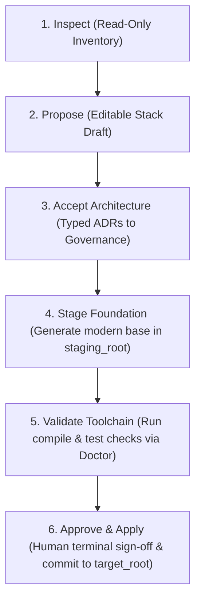
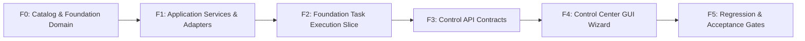

# Interactive Stack Recommender & Foundation Wizard — Implementation Plan (Revision 2)

Date: 2026-10-10  
Status: Proposed Architecture & Implementation Specification (Revision 2)  
Preceding Review: [foundation-stack-wizard-review-report.md](foundation-stack-wizard-review-report.md)  
Target Framework Baseline: Modern Angular 17.3.x LTS Standalone, Signals, and Bootstrap 5.3 Utilities  

---

## 1. Executive Summary & Purpose

The **Interactive Stack Recommender & Foundation Wizard** guides the project owner or maintainer through:
1. **Deterministic & Model-Assisted Source Inventory**: Extracting declared dependencies, lockfile packages, and heuristic AST usage from the read-only legacy source.
2. **Library & Dependency Mapping**: Mapping legacy libraries to concrete, tested modern equivalents with explicit replacement strategies (`REPLACE`, `NATIVE`, `REMOVE`, `CUSTOM`, `KEEP`).
3. **Architecture Decision Governance (ADRs)**: Synthesizing typed Architectural Decision Records (`ADR-001`, `ADR-002`, etc.) that respect existing accepted decisions, prevent overwrites, and support explicit supersession.
4. **Foundation Workspace Initialization (`step-001`)**: Extending the platform execution engine with a dedicated `foundation` task scope that generates a modern target workspace (`package.json`, `tsconfig.json`, `angular.json`, bootstrap files) into an explicit target directory.
5. **Decoupled 6-Stage Lifecycle**: Separating draft saving, architecture acceptance, foundation staging, toolchain validation, exact human approval, and controlled destination apply.

---

## 2. Fundamental Architectural Contracts

### 2.1 Explicit 4-Root Path Isolation (Resolving F01)
To ensure the source repository remains 100% read-only and mutations never collide, the platform strictly enforces four disjoint path roots:

```text
┌────────────────────────────────────────────────────────────────────────┐
│ 1. source_root     │ Read-Only legacy source (e.g. Ember app)          │
├────────────────────┼───────────────────────────────────────────────────┤
│ 2. governance_root │ Git-versioned external .agent/ repository         │
├────────────────────┼───────────────────────────────────────────────────┤
│ 3. staging_root    │ Ephemeral scratch tree for generation & test runs │
├────────────────────┼───────────────────────────────────────────────────┤
│ 4. target_root     │ Final destination for the modern Angular codebase │
└────────────────────────────────────────────────────────────────────────┘
```

- **Invariants**:
  - `source_root` is never modified, committed to, or used as the working tree for generated code.
  - `governance_root` holds ADRs (`.agent/decisions/`), access policies, and project manifests.
  - `staging_root` is where foundation files and transformed components are staged and validated against quality gates.
  - `target_root` is where approved ChangeSets are applied.
  - All four roots must be disjoint directories; overlapping or symlinked roots are rejected with `UNSAFE_PATHS`.

### 2.2 Executable Foundation Capability in the Execution Engine (Resolving F02)
- **Current Limitation**: `HostProposalService` and `TransformationService` restrict plan steps strictly to `component` and `service` scopes, rejecting other scopes with `SCOPE_UNSUPPORTED`.
- **Revision**: Introduce an explicit `foundation` scope in the domain:
  - **Step Declaration**: `MigrationStep(step_id="step-001", scope="foundation", ...)`
  - **Execution Adapter**: `FoundationTransformationAdapter` implements `ComponentRendererPort` / `WorkspaceInitializerPort` to deterministically render:
    - Root `package.json` (version-pinned dependencies, build/test scripts).
    - `tsconfig.json` & `tsconfig.app.json` (strict TypeScript, Angular compiler options).
    - `angular.json` (build/serve/test targets using `@angular/build`).
    - `src/main.ts` & `src/index.html` (standalone bootstrap).
    - `src/styles.scss` (Bootstrap 5.3 imports and theme configuration).
  - **DAG Prerequisite**: All functional migration steps (`component`, `service`) must declare `dependencies: ["step-001"]`. Functional transformation and staging remain strictly blocked until `step-001` achieves `APPLY_COMPLETED`.

### 2.3 The 6-Stage Decoupled Lifecycle (Resolving F03 & F05)
A browser click cannot simultaneously accept architecture, grant toolchain consent, and apply mutations. The wizard enforces a clean 6-stage progression:



| Stage | Operation / Action | State Mutation | Capability Required |
| :--- | :--- | :--- | :--- |
| **1. Inspect** | Read source packages & heuristic AST usage | None (Read-only) | `project.read` |
| **2. Propose** | Maintainer edits stack choices, saves draft | Saved draft in local state | `workflow.propose` |
| **3. Accept ADRs** | Generates typed ADRs, records into `.agent/decisions/` | Writes Markdown ADRs to governance | `decision.write` |
| **4. Stage Foundation** | Triggers `step-001` generation in staging | Writes files to `staging_root` | `changeset.stage` |
| **5. Validate** | Executes `ng build` / `tsc` checks under consent | Records validation result | `validation.authorize` |
| **6. Approve & Apply** | Human reviews diff, signs ChangeSet, commits to target | Writes to `target_root` | `changeset.apply` + Mode A/B |

---

## 3. Domain Model & Typed Contracts (`src/migration_agent/domain/stack.py`)

### 3.1 Domain Enums and Models (Resolving F06, F07 & F09)

```python
from enum import StrEnum
from pydantic import BaseModel, Field


class LibraryCategory(StrEnum):
    FRAMEWORK = "framework"
    DATA_LAYER = "data_layer"
    ROUTING = "routing"
    UI_STYLING = "ui_styling"
    UTILITY = "utility"
    BUILD_TOOL = "build_tool"
    TEST_RUNNER = "test_runner"
    OTHER = "other"


class ReplacementStrategy(StrEnum):
    REPLACE = "replace"  # Direct modern package equivalent
    NATIVE = (
        "native"  # Standard language/framework feature (still tracks required runtime packages)
    )
    KEEP = "keep"  # Supported as-is in modern stack (e.g. lodash-es)
    REMOVE = "remove"  # Obsolete/deprecated in modern architecture (e.g. bower, jquery)
    CUSTOM = "custom"  # Proprietary or unmapped; requires manual architectural review
    DEFERRED = "deferred"  # Excluded from initial foundation; migrated in later phase


class PackageCoordinate(BaseModel):
    name: str
    version_spec: str
    is_dev: bool = False


class LegacyDependency(BaseModel):
    name: str
    declared_version: str
    resolved_version: str | None = None
    category: LibraryCategory
    is_dev: bool = False
    manifest_path: str
    usage_evidence: list[str] = Field(default_factory=list)


class PackageMappingOutcome(BaseModel):
    legacy_name: str
    strategy: ReplacementStrategy
    target_packages: list[PackageCoordinate] = Field(default_factory=list)
    rationale: str
    behavioral_notes: str | None = None


class TargetStackPreset(BaseModel):
    preset_id: str
    label: str
    description: str
    target_framework: str  # e.g. "Angular 17.3.x (Standalone)"
    angular_version: str  # "17.3.12"
    typescript_version: str  # "~5.4.5"
    rxjs_version: str  # "~7.8.1"
    ui_library: str  # "Bootstrap 5.3.3 Utilities"
    test_framework: str  # "Vitest 1.6.x + @angular/build"
    directory_structure: dict[str, str]  # Path -> Semantic purpose


class StackRecommendationDraft(BaseModel):
    draft_id: str
    project_id: str
    source_revision: str
    governance_revision: str
    preset: TargetStackPreset
    mappings: list[PackageMappingOutcome]
    unmapped_count: int
    created_at: str
    updated_at: str
```

---

## 4. Curated Dependency Translation Catalog & Semantic Equivalents (Resolving F06)

The deterministic catalog lives strictly in **adapters** (`src/migration_agent/adapters/stack_catalog.py`), preserving core domain neutrality.

### 4.1 Target Preset Baseline: Angular 17.3 LTS

| Preset Attribute | Concrete Version / Value |
| :--- | :--- |
| **Angular Core / CLI** | `17.3.12` |
| **TypeScript** | `~5.4.5` |
| **RxJS** | `~7.8.1` |
| **Build System** | `@angular-devkit/build-angular` (`application` builder via Vite/esbuild) |
| **Unit Testing** | `vitest@^1.6.0` with `@analogjs/vite-plugin-angular` |
| **Styling** | `bootstrap@^5.3.3` + scoped SCSS |

### 4.2 Semantic Replacement Mapping Rules

| Legacy Package (Ember / JS) | Category | Strategy | Target Package(s) | Semantic & Behavioral Notes |
| :--- | :--- | :--- | :--- | :--- |
| `ember-source` (3.x) | Framework | `REPLACE` | `@angular/core@17.3.12`<br>`@angular/common@17.3.12` | Standalone components with modern control flow (`@if`, `@for`). |
| `ember-cli` | Build Tool | `REPLACE` | `@angular/cli@17.3.12`<br>`@angular-devkit/build-angular@17.3.12` | esbuild-based application build pipeline. |
| `ember-data` | Data Layer | `CUSTOM` | None (Initial foundation) | Ember Data identity map & record caching require custom typed REST services. Handled in feature phases. |
| `ember-cli-bootstrap-sassy` | UI Styling | `REPLACE` | `bootstrap@^5.3.3` | Modern Flexbox/Grid CSS utility classes; no jQuery or Bootstrap JS runtime required. |
| `moment` / `ember-moment` | Utility | `REPLACE` | `date-fns@^3.6.0` | Pure, immutable, tree-shakeable functions replacing mutable Moment instances. |
| `ember-concurrency` | Data Layer | `NATIVE` | `rxjs@~7.8.1` (Runtime dependency) | Generator tasks translate to RxJS streams and Angular Signals. |
| `jquery` / `ember-jquery` | Utility | `REMOVE` | None | Direct DOM manipulation is prohibited; state drives the DOM via Signals. |
| `ember-qunit` / `qunit` | Test Runner | `REPLACE` | `vitest@^1.6.0` | In-memory unit test runner replacing browser-bound Testem. |
| `lodash` | Utility | `REPLACE` | `lodash-es@^4.17.21` | Tree-shakeable ES modules. |

---

## 5. Architectural Decision Record (ADR) Governance (Resolving F04 & F09)

### 5.1 Reusing Typed ADR Models
ADRs generated by the wizard reuse the platform's canonical `ArchitecturalDecisionRecord` from [`src/migration_agent/domain/knowledge.py`](file:///c:/Projects/New%20folder/migration-agent/src/migration_agent/domain/knowledge.py):

```python
class DecisionStatus(StrEnum):
    PROPOSED = "proposed"
    ACCEPTED = "accepted"
    SUPERSEDED = "superseded"
    REJECTED = "rejected"
```

### 5.2 ADR Conflict Prevention & Supersession Protocol
1. **Load Existing Decisions**: The wizard calls `GitKnowledgeAdapter.list_decisions(governance_root)`.
2. **Prefill & Diff**: If an existing accepted ADR defines the target framework (e.g. `ADR-001`), the wizard displays it as accepted and pre-selects its settings.
3. **Collision-Safe Allocation**: If new decisions are generated, the service checks existing filenames and allocates the next unused sequential identifier (e.g. `ADR-004-styling-system.md`).
4. **Explicit Supersession**: If the maintainer changes an existing accepted decision, the wizard marks the old decision as `SUPERSEDED` and references it in the new ADR (`supersedes: ["ADR-001"]`). It never overwrites existing decision files on disk.

---

## 6. Control API Contracts & Idempotency (Resolving F08, F10 & F12)

All API endpoints are project-scoped and authenticated via the Control API session token.

### 6.1 `GET /api/v1/projects/{id}/stack/analysis`
- **Purpose**: Returns the read-only source inventory, existing accepted ADRs, and preliminary translation matches.
- **Response**:
  - `project_id`: Project identifier.
  - `source_framework`: Fingerprinted framework (e.g. `ember-classic`).
  - `dependencies`: List of `LegacyDependency` objects.
  - `existing_adrs`: List of existing accepted ADR summaries.
  - `readiness_status`: Current toolchain status (Node, npm, git).

### 6.2 `POST /api/v1/projects/{id}/stack/draft`
- **Purpose**: Persists or updates the maintainer's working draft without mutating governance or target files.
- **Payload**:
  - `request_id`: Idempotency token.
  - `preset_id`: Selected target preset.
  - `custom_mappings`: Overridden mappings.
- **Response**: `StackRecommendationDraft` with validated draft ID and content digest.

### 6.3 `POST /api/v1/projects/{id}/stack/accept-architecture`
- **Purpose**: Commits the accepted stack choices as typed ADRs into `.agent/decisions/`.
- **Payload**:
  - `request_id`: Idempotency token.
  - `draft_id`: Bound draft identifier.
  - `expected_draft_digest`: Cryptographic digest of the draft.
- **Behavior**:
  - Validates `decision.write` capability.
  - Writes new Markdown ADRs with frontmatter.
  - Returns updated knowledge projection and decision digests.

### 6.4 `POST /api/v1/projects/{id}/stack/stage-foundation`
- **Purpose**: Stages the `step-001` foundation task into `staging_root`.
- **Payload**:
  - `request_id`: Idempotency token.
  - `accepted_decision_ids`: List of accepted ADR IDs governing this foundation.
- **Behavior**:
  - Validates `changeset.stage` capability.
  - Invokes `FoundationTransformationAdapter` to generate the root files in `staging_root`.
  - Computes canonical `ChangeSet` digest for review.

### 6.5 Model Assistance Security Guardrails (Resolving F12)
- Optional LLM package assistance requires explicit `provider.use` capability.
- Request payloads must be sanitized (no secret-bearing tokens, registry URLs, or private keys).
- If the model is offline or unconfigured, the system gracefully falls back to deterministic catalog rules.

---

## 7. Control Center GUI: Stepper & User Experience (Resolving F10 & F11)

### 7.1 UX Flow & Channel Parity
The wizard is implemented as a routed Angular standalone component (`/workbench/:projectId/wizard/foundation`) to allow bookmarking, deep-linking, and session resilience:

```text
Step 1: Source Stack & Inventory Overview
   │
   ▼
Step 2: Target Framework & Architecture Preset
   │
   ▼
Step 3: Dependency Translation & Package Matrix
   │
   ▼
Step 4: Architecture Review & ADR Generation
   │
   ▼
Step 5: Staging & Toolchain Validation Summary
```

### 7.2 UI Guardrails & Accessibility
- **Draft Persistence**: Unfinished steps are saved as drafts. Navigating away or refreshing does not lose work.
- **Precedence Over Heuristics**: The wizard launcher on `SummaryPage` checks authoritative backend readiness (`/api/v1/projects/{id}/stack/status`), not heuristic reference counts.
- **No Pseudo-Approval Buttons**: Action buttons are explicitly labeled:
  - *"Save Working Draft"*
  - *"Record Architectural Decisions"*
  - *"Stage Foundation Files"*
  - *"Proceed to Validation & Terminal Review"*
- **Strict Accessibility**: Conforms to WCAG AA, full keyboard navigation, ARIA live status announcements, and zero reliance on color alone.

---

## 8. Implementation Milestones



### Milestone F0: Catalog & Foundation Domain
- Define `src/migration_agent/domain/stack.py` contracts (`LegacyDependency`, `PackageMappingOutcome`, `TargetStackPreset`).
- Implement deterministic catalog in `src/migration_agent/adapters/stack_catalog.py` for Ember Classic / JS to Angular 17.3 LTS.
- Unit tests for translation rules and mapping outcomes.

### Milestone F1: Application Services & ADR Generator
- Implement `StackAnalysisService`: Reads declared manifests and AST usage via `InventoryService`.
- Implement `StackRecommendationService`: Synthesizes recommendations, detects ADR conflicts, and generates typed `ArchitecturalDecisionRecord` models.
- Tests verifying ADR generation, supersession handling, and frontmatter validation.

### Milestone F2: Foundation Execution Slice in Backend
- Extend `HostProposalService` and `TransformationService` to support the `foundation` scope.
- Implement `FoundationTransformationAdapter`: Deterministically renders `package.json`, `tsconfig.json`, `angular.json`, `src/main.ts`, `src/index.html`.
- Wire `ApplyFiles` to respect `target_root` destination.
- Verify that `step-001` can be staged, validated (`ng build` / `tsc`), and applied in offline test fixtures.

### Milestone F3: Control API Endpoints
- Implement REST routes under `/api/v1/projects/{id}/stack/*` in `src/migration_agent/adapters/control_api/server.py`.
- Enforce idempotency tokens, draft digests, and capability checks.
- API contract tests and session authentication tests.

### Milestone F4: Control Center GUI Stepper
- Build Angular standalone components in `ui/control-center/src/app/workbench/wizard/`:
  - `StackWizardComponent` (Routed coordinator).
  - `StepSourceInventoryComponent` (Inventory & metrics).
  - `StepTargetPresetComponent` (Preset & architecture selection).
  - `StepPackageMatrixComponent` (Interactive mapping table).
  - `StepAdrReviewComponent` (Markdown diff viewer).
- Replace heuristic `archCount === 0` on `SummaryPage` with typed backend readiness status.
- Vitest unit tests (`npm run test`) covering forms, signals, and error states.

### Milestone F5: Full Quality Gates & End-to-End Acceptance
- Run full end-to-end synthetic migration from read-only Ember source to independent target directory.
- Verify the 10 acceptance criteria from `foundation-stack-wizard-review-report.md`.
- Execute mandatory platform quality gates:
  ```bash
  uv sync --all-groups
  uv run pytest
  uv run ruff check .
  uv run ruff format --check .
  uv run mypy src
  uv run migration-agent doctor
  npm run test --prefix ui/control-center
  ```
