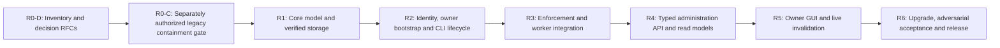

# Project RBAC implementation plan

Date: 2026-10-09  
Specification revision: 1.2 — all milestones authorized; Git-member integration included  
Status: Implementation authorized on 2026-10-09; R0 in progress  
Scope: Core authorization, identity and trust, storage, CLI/MCP/Control API,
background execution, project-owner administration and Control Center GUI  
Delivery: The user authorized all required user-management/RBAC implementation on
2026-10-09. Execute R0–R6 sequentially with their quality gates; this authorization
includes the R0-C containment patch and accepted architecture baseline. It does
not authorize signing real governance changes or changing the migration source.

## 1. Purpose and authoritative requirements

Implement the role-based access model already required by the platform, including
the missing owner administration experience. Roles provide project-scoped sets of
capabilities. Core services enforce capabilities and security conditions, rather
than comparing display role names. Identity, authorization, execution consent and
exact artifact approval remain separate decisions.

Authoritative references:

- [Master plan, Section 9 and invariants 19–24, 29, 33 and 39](final/agent-platform-master-plan.md).
- [Current phase status](../docs/phase-status.md).
- [Control Center architecture and operations](../docs/control-center.md).
- [Shared workflow and approval boundary](../docs/phase-16-host-workflow.md).
- [Native execution consent](../docs/native-validation.md).
- [Project-work ownership metadata](../docs/project-work.md).
- [Separate migration-session governance](../docs/end-user-acceptance-hardening.md).

These requirements govern the implementation:

1. Every governed project has an explicit, verified access policy and principal
   membership. Creating a manifest or possessing a browser token grants no role.
2. Role, permission, owner and authority changes require authorization under the
   currently active policy and an exact human-approved Mode A signature.
3. Trust originates outside repository files. A proposed policy cannot introduce
   the authority that approves its own adoption.
4. CLI, API, GUI and MCP use the same application authorization boundary. Jobs
   re-authorize when they start and before consequential execution.
5. The GUI manages access through typed API proposals and shows signing handoffs.
   It cannot mint approval or downgrade human-only signing requirements.
6. The selected migration source stays read-only. External governance is supported;
   source, governed metadata, staging, state and trust roots have explicit bindings.
7. All schemas and transitions are deterministic and versioned. Unknown capabilities,
   ambiguous identities, invalid signatures and uncertain recovery fail closed.

## 2. Current implementation and gaps

The following observations come from the current workspace, not from assumptions
about what the plan intended to deliver.

| Area | Implemented behavior | Gap to resolve |
| --- | --- | --- |
| Governance scaffolding | `GitGovernanceAdapter` creates `roles.json` and `principals.json` | No effective principal-to-role resolution; legacy admin uses `*` |
| Inspection authorization | `InspectionContext` and `authorize_inspection` check capability and assurance | Grants originate in launcher settings, not signed project membership |
| Workflow authorization | `WorkflowContext` and `authorize_workflow` enforce launcher grants | No project RBAC policy resolution or current-policy revision binding |
| GUI launch | CLI maps the OS username and configured grants into the workbench context | No stable security principal resolution or owner-controlled membership |
| Browser security | Loopback session, Origin and CSRF checks exist | Transport authentication does not establish a project role |
| Background work | `WorkflowRuntime` dispatches persisted operations and runs guarded services | Authorization identity/revision must survive queueing and be rechecked |
| Exact apply | Shared `ApplyService` checks evidence, consent, approvals and source drift | Approval and executor authorization need current RBAC bindings |
| Modern signing | `LocalApprovalProof` performs genuine Ed25519/SSH verification | Generalize securely for identity challenges and access-policy approvals |
| Legacy signing | `CryptoSignatureVerifierAdapter` computes HMAC using public-key text and can return Mode A | This is not asymmetric identity proof; prohibit it from RBAC and audit legacy routes |
| Trust persistence | A local trust store and repository binding models exist | Malformed trust is sometimes treated as absent; bootstrap and binding checks need fail-closed lifecycle rules |
| GUI ownership | Project-work items display an `owner` string | Descriptive task ownership has no security effect |
| GUI administration | No members, roles, effective-permission or owner-transfer feature | Add an explicitly scoped Access & security feature |
| Source isolation | External migration initialization records separate roots | Runtime governance resolution must support a verified external binding consistently |

Relevant implementation locations:

- [Governance adapter](../src/migration_agent/adapters/governance.py).
- [Inspection capabilities](../src/migration_agent/domain/inspection_access.py) and
  [workflow capabilities](../src/migration_agent/domain/workflow_access.py).
- [Settings](../src/migration_agent/config.py) and [CLI composition](../src/migration_agent/cli.py).
- [Trust schemas](../src/migration_agent/domain/trust.py),
  [legacy trust/signature adapter](../src/migration_agent/adapters/trust_store.py) and
  [shared approval proof](../src/migration_agent/adapters/approval_proof.py).
- [Workflow runtime](../src/migration_agent/adapters/workflow_runtime.py),
  [ApplyService](../src/migration_agent/application/apply.py) and
  [approval records](../src/migration_agent/domain/apply_approval.py).
- [Workbench adapter](../src/migration_agent/adapters/workbench.py),
  [Control API server](../src/migration_agent/adapters/control_api/server.py) and
  [MCP server](../src/migration_agent/adapters/mcp/server.py).
- [GUI session state](../ui/control-center/src/app/core/session/session-state.ts),
  [typed view models](../ui/control-center/src/app/workbench/workbench.models.ts) and
  [routes](../ui/control-center/src/app/workbench/workbench.routes.ts).

The legacy verifier is a critical prerequisite, not evidence that the newer shared
apply verifier is bypassed. R0 must trace each caller and distinguish legacy plan
approval from genuine shared ChangeSet authorization before changing behavior.

## 3. Scope and operating model

### 3.1 Included

- Local, project-scoped owner, maintainer, developer, reviewer and viewer roles.
- Explicit principal membership, account/key bindings, custom finite-capability
  roles, membership suspension/revocation and effective-permission explanation.
- Out-of-band owner bootstrap; signed access-policy changes; authority delegation,
  key rotation/revocation; ownership transfer and bounded recovery.
- Enforcement for repository evidence, provider disclosure, planning, staging,
  validation, repair, approval, apply, recovery, governance and packaging commands.
- CLI administration, typed Control API proposals, GUI administration, audit views,
  worker/replay authorization and schema migration.
- Windows and Linux; Python 3.12+; offline tests and existing Angular GUI conventions.
- Import existing governance-repository members from GitHub and GitLab, bind stable
  provider account IDs to verified agent identities and let the owner assign agent
  roles. Import does not create Git accounts or modify Git-server roles.
- A trusted governance publication verifier and remote-protection readiness checks;
  do not claim remote push prevention until owner-controlled server enforcement is
  installed and verified on the selected Git host.

### 3.2 Explicit boundaries

- No hosted identity server, passwords, email invitations, SSO or remote multi-user
  web hosting. Adding a member means registering public identity bindings and roles.
- No claim that application RBAC restricts direct filesystem access by the same OS
  account, a workstation administrator, or a replaced platform binary.
- No new permission to send messages, install tools, call providers, execute source
  scripts, change selected source code or approve migration artifacts.
- No browser-native human signing channel in this scope. The GUI supports the
  complete proposal/review/status experience; trusted terminal signing remains.
- Project scope is the first resource boundary. Task assignment remains descriptive;
  task-level ACLs, organization hierarchies and role inheritance are deferred.
- Standalone service-account credential infrastructure is deferred. Current agent
  clients use narrowly delegated sessions tied to a verified initiating principal.
- SSH Ed25519 is the initial supported public-key mechanism because a genuine
  implementation already exists. Unsupported GPG/key algorithms are explicit;
  do not present the initial implementation as full SSH/GPG parity.

## 4. Proposed architectural decisions

Record these as proposed ADRs in R0. Accept them explicitly before implementing
their security/storage behavior; they are not accepted decisions merely because
this planning document contains them.

| ADR | Proposed decision | Consequence |
| --- | --- | --- |
| RBAC-01 | A shared application authorization service resolves signed project membership and capability sets | Transport adapters cannot manufacture authority |
| RBAC-02 | Stable principal IDs; OS account identities and public-key fingerprints are bindings, not display-name matching | Git author names/emails and client-supplied actor strings cannot impersonate members |
| RBAC-03 | Roles contain explicit registered capabilities; no wildcard expansion or inheritance | New capabilities are denied until explicitly granted |
| RBAC-04 | Security changes are authorized by the old policy and signed against exact proposed bytes | Prevents policy self-authorization |
| RBAC-05 | Access governance uses immutable revision bundles and an atomic active pointer | Multi-file policy changes cannot expose mixed effective permissions |
| RBAC-06 | Every session/job is bound to a principal, project, client kind and current access revision | Revocation applies to existing sessions and queued work |
| RBAC-07 | Ownership is a signed security relationship with last-owner safeguards; task-owner strings are unrelated | Ownership transfer becomes an explicit controlled transition |
| RBAC-08 | Human-terminal signing remains the authoritative channel for access changes | GUI confirmation and agent tool requests cannot sign policy changes |
| RBAC-09 | A verified external governance binding is supported for read-only migration sources | No access-management files need to be written into the selected source |
| RBAC-10 | Unsupported/legacy access state permits only bounded safe inspection and migration preparation | Existing scaffolding never silently becomes an owner grant |

## 5. Core domain and authorization semantics

### 5.1 Proposed typed contracts

Names below describe contracts to implement in their milestone, not classes to
create speculatively in the current planning request. Use Pydantic frozen models
with `extra="forbid"`, bounded fields and explicit versions.

| Contract | Required information |
| --- | --- |
| `PrincipalId` / `Principal` | Opaque stable ID, display label, active/suspended/revoked status, public identity bindings, registered public keys |
| `IdentityBinding` | Binding kind, Windows SID or Linux UID plus verified local realm, or public-key fingerprint; no credentials |
| `AuthenticatedActor` | Resolved principal, authenticated binding, assurance, verification reference, client kind, initiating-human reference when delegated |
| `RoleDefinition` | Opaque role ID, display label, description, explicit capability IDs, reserved/custom classification |
| `ProjectMembership` | Principal ID, assigned role IDs, membership status, project security ID |
| `OwnershipRecord` | Active owner principal IDs and lifecycle constraints; separate from task metadata |
| `AccessSnapshot` | Schema version, project security ID, revision, previous digest, roles, principals, memberships, owners, constraints and content digest |
| `AuthorityDelegation` | Existing issuer, delegated public key/principal, allowed purpose/project scope, signature and revocation status |
| `AuthorizationRequest` | Actor reference, capability, typed project/resource reference, operation kind, expected access digest where necessary |
| `AuthorizationDecision` | Allow/deny, stable reason code, resolved principal, policy revision/digest, assurance requirement and bounded explanation |
| `AuthorizedOperationContext` | Trusted actor/project reference, requested capability, access digest, client ceiling and expiry; server-created only |
| `AccessChangeProposal` | Proposal ID, typed mutations, base/proposed full digests, selected storage locator, required capabilities, public diff, expiry, request ID and proposer attribution |
| `AccessChangeApproval` | Exact proposal/base/proposed digest, project binding, approving principal/key, purpose, nonce, timestamps and real signature |
| `ProjectSecurityBinding` | Logical security project ID, governance repository identity, selected source/target identities and local binding reference |

Do not put Typer, HTTP, SQL, paths-to-signers or SDK objects into domain contracts.
Artifact/resource references must resolve through trusted application ports.

### 5.2 Effective capability calculation

For a governed project, compute:

```text
role_grants = union(capabilities of the active member's valid assigned roles)
effective_grants = role_grants intersect trusted_launcher_ceiling intersect client_ceiling
allow = active_identity_and_membership
        and project_and_resource_binding_match
        and requested_capability in effective_grants
        and required_assurance_satisfied
        and current_policy_constraints_satisfied
        and required_execution_consent_and_exact_approval_satisfied
```

Additional rules:

- The owner role has a finite shipped template, not `*`. Core authorization checks
  capability IDs, assurance and constraints; it does not branch on role labels.
- Ownership transitions additionally validate the signed ownership relationship.
  A custom role label called "owner" does not create an owner.
- No role inheritance or deny-rule language in the first release. Restrictions are
  explicit policy predicates and intersection ceilings, avoiding ambiguous merges.
- Unknown capabilities/roles, duplicate IDs, dangling memberships, unsupported
  schemas, cycles in authority delegation or invalid key bindings block activation.
- `workflow.execute` from old scaffolding is not an implicit grant of every action.
  Enumerate each capability in the migration preview; do not guess old intent.
- Local settings and MCP capability variables may narrow permissions. They cannot
  grant an unassigned capability or lower a protected assurance requirement.
- A browser session cookie authenticates the session only. Role strings or actor
  fields supplied by a client never enter the trusted actor resolver.
- Registered capabilities are versioned. Plugin capabilities require platform
  validation and explicit signed grants; owner templates do not expand on upgrade.
- Ownership does not bypass protected paths, source-read-only mode, provider
  disclosure rules, validation prerequisites, consent or exact approval.

### 5.3 Capability catalog and default roles

R0 must inventory every reachable command/route/tool and assign a catalog entry.
Reuse current capability identifiers where their semantics are sound. Add missing
entries explicitly rather than treating all writes as `workflow.execute`.

Suggested catalog additions include `access.self.read`, `access.read`,
`access.change.propose`, `access.change.approve`, `access.change.commit`,
`access.owner.transfer`, `access.authority.delegate`, `access.authority.revoke`,
`policy.write`, `approval.record`, `validation.authorize`, `workflow.recover`,
`decision.write`, `challenge.write`, `solution.write`, `learning.approve` and
`provider.disclose`. Final naming is frozen in R0 with mappings for existing enums.

The following is the proposed default role matrix. Each grouped row must expand
into explicit capability IDs in the implementation. Custom roles cannot bypass
the additional assurance, signature or consent conditions.

| Operation family | Owner | Maintainer | Developer | Reviewer | Viewer |
| --- | --- | --- | --- | --- | --- |
| Read project, evidence, runs, plans, diffs and recorded checks | Yes | Yes | Yes | Yes | Yes |
| Read own effective access | Yes | Yes | Yes | Yes | Yes |
| Read member/role administration details | Yes | No | No | No | No |
| Submit analysis/plans and bounded repairs | Yes | Yes | Yes | No | No |
| Stage and run validation under required consent | Yes | Yes | Yes | No | No |
| Record ordinary decisions/challenges/solutions | Yes | Yes | Yes | No | No |
| Request an exact review | Yes | Yes | Yes | Yes | No |
| Record exact human ChangeSet approval | Yes | No | No | Yes | No |
| Execute an independently approved apply | Yes | Yes | No | No | No |
| Human native execution authorization | Yes | Yes | No | No | No |
| Cancel project operations and reconcile recovery | Yes | Yes | No | No | No |
| Propose access changes | Yes | No | No | No | No |
| Approve/commit access changes | Yes | No | No | No | No |
| Transfer ownership or manage authority delegation | Yes | No | No | No | No |
| Change security policy or approve curated learnings | Yes | No | No | No | No |

Members may receive multiple roles, for example maintainer plus reviewer, through
an explicit signed assignment. Optional separation-of-duties policy can prohibit
the same principal from proposing and approving a migration ChangeSet; do not
pretend that different display actor strings satisfy separation.

Provider disclosure requires both a capability and the existing explicit selected
provider/payload policy. No role alone enables external disclosure. Native consent
and exact approval retain their independent human interaction requirements.

### 5.4 Assurance and client restrictions

| Situation | Minimum assurance / condition |
| --- | --- |
| Generic diagnostics and unmanaged safe inspection | Mode C where existing public inspection permits; no access administration or mutation authority |
| Governed repository evidence and workflow activity | Active project membership; Mode B or stronger as required by policy |
| Role/member/security-policy mutation, owner transfer and authority changes | Mode A plus exact human-approved signed transition |
| Local-development apply | Existing policy minimum plus active executor and approver permissions; never below Mode B |
| Production apply | Mode A as required by the master plan; environment classification must be explicit, not inferred from a directory name |
| Native execution | Independent accepted human consent plus current permissions and backend policy |
| Agent/MCP session | Delegated capability ceiling; never human approval, access commit, trust bootstrap or unconstrained signing |

Mode B is eligible for ordinary local-development inspection, proposal preparation,
staging and policy-permitted execution with independent consent. It is **not** an
exception for role/member/permission activation, even in a single-user project.
Section 9 of the master plan requires an independently accepted authority signature
for those security changes. An authenticated local session token does not prove an
exact human signing decision and cannot turn Mode B into Mode A.

Avoid unnecessary ceremonies: prepare/edit access proposals in the GUI under an
eligible local member session, batch related role assignments into one exact
proposal and require one review/signature for that candidate. Unapproved synthetic
role previews may simulate UI presentation without granting real permissions;
test-only injected human/signing fixtures must remain unavailable in production.
Ordinary reports and state records do not acquire a signing requirement.

A future Mode B access-administration mode would require an explicitly authorized
amendment to the master-plan trust/signature invariants and a separately accepted
human-decision threat model. It is outside this specification; neither repository
configuration nor a GUI checkbox can introduce it as a convenience fallback.

Inspection-only operation before bootstrap must be clearly labelled. A malformed
initialized policy is not an unmanaged project and must not trigger permissive
fallback. Governed reads are subject to RBAC even when the user can independently
read the files through the OS outside the platform.

## 6. Identity, trust and ownership lifecycle

### 6.0 Existing Git members and verified enrollment

Provide a bounded read-only Git directory adapter for GitHub/GitLab behind a typed
port. Use an explicitly selected governance host/repository and an authenticated
installed provider client; never read or expose its stored credentials. Enumerate
effective direct/inherited membership where the provider permits, with pagination,
timeouts and explicit partial/unavailable states. A Git checkout/commit log is not
a user directory. Provider roles remain informational and cannot auto-grant ownership.

The owner selects existing accounts in Members -> Import Git members, reviews the
agent role/capability assignments and submits one signed access-change proposal.
Persist the provider kind, normalized hostname, immutable repository/account IDs
and verified membership evidence reference; display usernames as mutable labels.
An imported member is pending until its approved OS/public-key binding is enrolled
and possession is verified. An account ID alone cannot authenticate a local user.

All imports enter the same old-policy authorization, last-owner, exact signature,
revision and activation rules. Membership refresh reports revoked/expired/stale Git
membership without silently escalating roles. Define an explicit owner-approved
freshness/enforcement policy; unavailable providers cannot grant new access. The GUI
keeps provider permission and agent permission columns separate. Read-only import
requires no account-creation or repository-administration API permission.

Remote publication needs an independently deployed trusted verifier/protected
authoritative governance refs. Verify full signed role, constraint and security-rule
content against the old anchor, protect validator/CI/owner-configuration changes and
inspect all relevant proposed refs. Local hooks are advisory. Expose remote
enforcement as unverified until owner-controlled server evidence is available;
an agent role assignment never changes Git-server permissions automatically.

### 6.1 Initial owner bootstrap

1. Inspect the explicit governance/source binding without changing the source.
   Resolve a security project ID separately from path-derived operational IDs.
2. Verify governance repository identity and the selected source binding. For an
   external project, initialize Git governance through a product command in that
   external directory if it is not yet a repository; never initialize Git in the
   read-only source. Reject overlapping roots, links and credential-bearing URLs.
   Require the selected governance root to be its actual Git/worktree root; do not
   accidentally anchor an external directory to an enclosing platform checkout.
3. Collect the intended owner principal and a supported **public** key. Verify
   its fingerprint and proof of possession through a bounded fresh challenge.
4. Show the human the exact project/binding, owner, authority key, default role
   matrix and initial signed policy digest in a trusted terminal.
5. Record the explicit out-of-band trust decision and bootstrap snapshot together
   using a recoverable transaction. Git contents alone cannot supply this decision.
6. Activate the first owner/membership only when trust, signature, binding and
   active-pointer checks agree. A browser click or unattended `--yes` cannot bootstrap.
7. Record public bootstrap provenance. Never read, write, upload or log private
   keys, SSH-agent credentials, browser secrets or raw environment variables.

Public-key proof of possession proves control of a key; the local trust decision
does not certify universal repository ownership. Human-only review limitations
under the same OS account must remain explicit.

### 6.2 Authentication and session mapping

- Resolve Windows principals through stable OS SID identity; Linux identities use
  UID plus the explicitly registered local realm/host binding. A username is a label.
- Implement Windows SID resolution with standard-library `ctypes`/`ctypes.wintypes`:
  query the current process token with `TOKEN_QUERY` using `OpenProcessToken`, read
  `TokenUser` with the bounded two-call `GetTokenInformation` buffer protocol and
  convert its SID with `ConvertSidToStringSidW`. Declare pointer-safe `argtypes` and
  `restype`, use the Unicode API and preserve error codes. Close the token handle
  and release the returned SID string with `LocalFree` on every path. The API
  functions are exported by Advapi32; handle/allocation cleanup uses the appropriate
  Kernel32 functions. No new `pywin32` or compiled SID dependency is needed. See
  [OpenProcessToken](https://learn.microsoft.com/en-us/windows/win32/api/processthreadsapi/nf-processthreadsapi-openprocesstoken),
  [GetTokenInformation](https://learn.microsoft.com/en-us/windows/win32/api/securitybaseapi/nf-securitybaseapi-gettokeninformation)
  and [ConvertSidToStringSidW](https://learn.microsoft.com/en-us/windows/win32/api/sddl/nf-sddl-convertsidtostringsidw).
- A deterministic compatibility backend may use the verified installed system
  `whoami.exe` with fixed arguments `/user /fo csv /nh`, `shell=False`, a bounded
  timeout/output and a sanitized environment. Resolve the executable from a trusted
  Windows system-directory API, not source/staging or unconstrained PATH. Parse one
  CSV record with the standard library, validate the SID and test locale/encoding,
  quoting, malformed/multiple rows and nonzero exit status. Do not parse the default
  human-readable table. Microsoft documents the
  [CSV/no-header options](https://learn.microsoft.com/en-us/windows-server/administration/windows-commands/whoami).
- Record the selected identity backend. Fallback is allowed only for a specifically
  classified unsupported primary backend and the same supported process-token
  execution context. Access denied, invalid SID, impersonation/token ambiguity or
  mismatched results fail closed; do not "try whoami" to bypass an identity error.
  Thread impersonation is unsupported in this local launcher model until a distinct
  effective-token contract is accepted. Test both resolution paths without elevation.
- One registered public key fingerprint maps unambiguously to one active principal
  within a project. Duplicate or conflicting bindings fail closed.
- Local Mode B membership is explicitly registered; absent membership does not
  inherit the launcher user's default full capability list.
- Stronger sessions use a single-use, expiring, project/session/origin/purpose-bound
  challenge verified by a trusted terminal and public-key verification adapter.
- R0 freezes explicit lifetime defaults and maxima. Proposed defaults: five-minute
  identity challenges, fifteen-minute access-change approvals and one-hour GUI
  sessions. Expiry uses a trusted injected clock; tests cover skew and restarts.
- Challenge signatures cannot be reused as access-change or ChangeSet approvals.
  Require distinct signature namespaces/purposes and exact typed digests.
- Session actor/project is immutable. Changing identity means creating a new verified
  session and clearing cached project evidence. No role/actor headers or query grants.
- Keep session tokens transient and opaque; no tokens in audit, localStorage, URLs
  retained in history, proposal files or job records. Support expiry and logout.
- Current loopback deployment is one trusted local OS context. It is not a shared
  remote multi-person portal; remote browser access remains unsupported.

### 6.3 Member and role management

- Register a principal using public identity bindings; assign explicit roles via a
  proposed signed change. There is no email-delivery or password workflow.
- Distinguish an unbound/pending principal from an active member. New key bindings
  require proof of possession before granting strong identity assurance.
- Built-in role templates are versioned and reserved. Custom roles use a finite
  capability catalog and public descriptions; reject wildcard/unregistered entries.
- Role updates show all affected members and gained/lost permissions before review.
- Suspend/revoke members and keys without deleting historical attribution. Restore
  membership with a new signed change; revoked credentials do not revive implicitly.
- An administrative change requires the capability and a currently accepted
  authority signer. These facts are checked independently under the old snapshot.
- A key enrolled for authentication or migration approval is not automatically an
  access-policy authority. Delegation and verification check permitted purposes.

### 6.4 Ownership, delegation and recovery

- Maintain at least one active owner with a usable accepted authority path. Reject
  removing/suspending the last owner or revoking its last usable authority key.
  Verify candidate owner eligibility, identity binding and administrative capabilities
  as well as a supported non-revoked authority key; an active label alone is insufficient.
  This checks registered eligibility, not physical availability of a lost hardware key.
- Owner transfer names the recipient, verifies its identity/key possession and
  records recipient acceptance before the atomic signed ownership transition.
- Granting owner status and delegating authority are explicit signed effects; neither
  automatically follows from a role label or a new key in repository files.
- New authority keys require delegation by an existing authorized trusted signer,
  bound to the project and allowed signature purposes. Revocation is durable.
- Key rotation establishes the replacement and proves possession before retiring
  the old key. Re-evaluate last-owner availability as part of the same transition.
- A lost last authority requires explicit out-of-band recovery/rebootstrap with
  prominently displayed changed trust and binding, audit provenance and invalidated
  sessions/approvals. Ordinary GUI role editing cannot become a recovery bypass.
- Recovery is a new signed trust epoch, not silent acceptance of an older policy.
  No autonomous agent recovery or configurable "disable RBAC" switch is allowed.

## 7. Governance storage, integrity and concurrency

### 7.1 Proposed atomic storage layout

This is an explicit extension of the master plan's root-level `roles.json` and
`principals.json` layout. Accept RBAC-05 and update that layout during R1, rather
than silently introducing two authoritative stores.

```text
Governance repository (writable project root or explicitly bound external project)
  .agent/access/
    current.json                  # Atomic pointer to the accepted revision/digest
    revisions/rev-<digest-prefix>/
      roles.json                  # Explicit role-to-capability definitions
      principals.json             # Public identities, memberships and ownership
      constraints.json            # Required assurance and protected policy rules
      manifest.json               # Versions, binding, previous digest, content hashes
      approval.json               # Exact signed transition and authority delegation

External local user-data / selected state and trust roots
  trust/<security-project-id>.json # Bootstrap anchor, accepted epoch/revision floor
  state/checkpoints.db            # Operations, proposals, sessions/revocations, audit
  state/audit.jsonl               # Derived redacted audit mirror
  state/access-proposals/         # Bounded proposal artifacts, never private keys
```

Use `rev-` plus a validated 16-character lowercase SHA-256 prefix as the default
directory locator. Keep the **full** SHA-256 content digest in the signed manifest,
active pointer, proposal, approval and accepted trust checkpoint; a prefix never
proves identity or signature validity. Canonical API digests may retain `sha256:`;
never put that colon-bearing value directly into a Windows filename.

Truncated prefixes are not guaranteed unique. Before reserving a locator, compare
the complete verified digest if its directory exists. Reuse it only for the same
immutable bundle; never overwrite a different bundle. Freeze a deterministic
collision policy in R0: extend the locator to 24, then 32 hex characters when
necessary, with full-digest verification at every step. If still conflicting or
outside the path budget, fail with `REVISION_LOCATOR_CONFLICT`; no content repair,
random alias or unchecked "unique prefix" assumption. Bind the selected locator
to the proposal/active pointer; a collision discovered after approval requires a
new reviewed locator proposal rather than silent remapping. Locator reservation
and activation obey the access coordination lock.

Compute the policy content digest independently of its storage locator, its own
digest field and approval signatures; otherwise deriving a prefix from that digest
creates a self-reference. The approval envelope separately binds the selected
locator and full policy digest. Validate locator syntax strictly (`rev-` plus the
supported hex lengths) and verify full content/file hashes after resolving it.

Short names mitigate path length; they do not guarantee compatibility for an
arbitrarily deep root. Preflight every governance, candidate, temporary, lock and
backup path before any write. The proposed compatibility budget is 240 UTF-16 code
units for the complete absolute Windows path, accounting for fixed suffixes and
directory creation headroom. Freeze the exact budget in R0 and test boundary,
non-ASCII, UNC and error-206 cases. Fail with `ACCESS_PATH_TOO_LONG` and recommend
a shorter disjoint external root; do not silently move data or modify registry policy.

The familiar 260-character constraint is a Win32/application compatibility limit,
not a universal filesystem limit. Long-path support varies by API/application and
opt-in configuration, so do not infer Git/Node/browser tooling support from Python
alone. See Microsoft's
[maximum-path guidance](https://learn.microsoft.com/en-us/windows/win32/fileio/maximum-file-path-limitation).
Migration source repositories use external governance; co-located governance is
for an explicitly writable authoritative project, and governance must not be
nested inside the staging root.

Only the revision selected by the verified active pointer is effective. Existing
root-level role/principal files are legacy import inputs after migration, not a
second live policy. Do not silently follow edited legacy mirrors. Keep migration
backups with explicit ownership and document their non-authoritative status.

Use canonical JSON and deterministic ordering for security digests. Bind the
project, schema/capability-catalog version, revision, previous digest and full
candidate content. Signature fields are excluded from the content they sign;
approval purpose, nonce and timestamps are included in the approval digest.

### 7.2 Trusted loading and rollback protection

- Read bounded regular files through existing controlled-path defenses. Reject
  symlinks/junctions/reparse points, duplicate JSON keys, invalid schemas, unknown
  security fields, hash mismatches, unsupported signatures and malformed trust.
- Verify signatures against an independently bootstrapped anchor and authorized
  delegation chain, not just a public key found in the new snapshot.
- Approval expiry/nonce consumption is checked at activation. An already accepted
  snapshot does not expire when its historical approval does. Loading verifies the
  committed transition/accepted checkpoint and chain; arbitrary repository claims
  about past activation time cannot replace trusted activation evidence.
- Persist a local accepted revision/digest floor. Reject rollback, same-revision
  substitution, gaps without an accepted chain and incompatible trust epochs.
- A new workstation needs an explicit trust decision for an acceptable checkpoint.
  Offline local verification cannot certify that no newer policy exists remotely.
- Git merge/rebase/copy cannot bypass signed activation. Conflicting policy histories
  require reconciliation as a new authorized transition, not last-file-wins loading.
- Use the current local binding to resolve logical project identity. Do not replace
  existing path-derived workflow IDs casually or reuse another project's store.

### 7.3 Controlled change protocol

```text
Read verified current snapshot
  -> authorize proposing actor under current policy
  -> validate typed candidate and calculate exact public diff
  -> persist proposal outside source (no effective permission change)
  -> trusted human reviews and signs exact base/candidate/purpose/expiry/nonce
  -> re-authorize proposer/approver/committer and verify current base
  -> acquire short-lived access coordination fence in the declared lock order
  -> acquire required apply/workspace locks and the access-scoped writer lease
  -> persist immutable candidate bundle and durable activation intent
  -> atomically activate verified pointer and advance trust revision floor
  -> verify postconditions and append audit / invalidate sessions and approvals
```

The transition is approved by the **old** policy. After activation, only the new
snapshot authorizes subsequent requests. The access lock must be global to the
security project across all configured state directories, matching the existing
apply-lock safety principle.

#### 7.3.1 Lock hierarchy and policy-read contract

Declare and enforce this acquisition order for every relevant writer:

```text
Global-to-project AccessCoordinationLock
  -> ProjectApplyLock
    -> Workspace/StagingMutationLock (only if required and implemented)
      -> resource-scoped fenced writer lease
        -> short SQLite transaction
```

"Global" means shared by all local processes/state directories for the same
verified project binding, not one mutex for unrelated projects. Read-only snapshot
loading does **not** acquire the access writer lock. No writer may acquire an
earlier lock while holding a later lock, including recovery/rollback paths.

The inspected `LocalControlledFiles` currently uses passed per-mutation fencing,
not a separate OS lock. Current native validation also does not hold the apply OS
lock for its entire run. R0 must map those actual boundaries rather than assume
three existing locks. Introduce a workspace lock only in an authorized milestone
if its concurrency requirements warrant one; existing file fences remain mandatory.

Policy reads during apply/validation are non-blocking reads of a verified immutable
revision through the active pointer. Read pointer/activation status, resolve and
verify the exact bundle/trust checkpoint, and recheck the pointer with a bounded
retry if it changed. A cached snapshot is usable only with a verified current
binding. Unstable or inconsistent activation returns an explicit updating/integrity
denial; a read never waits for the writer lock or promotes an unverified candidate.

#### 7.3.2 Short activation fences and safe apply checkpoints

- Model generation, subprocess validation, human signing and expensive preparation
  run outside OS mutation locks. Re-authorize and recheck inputs after acquiring
  the ordered locks; preparation outside a fence grants no later write authority.
- The initial safe apply checkpoint is the whole bounded controlled-apply transaction
  or completed verified rollback. Do not interleave policy activation with an
  arbitrary file boundary in a partially applied ChangeSet. Finer checkpoints
  require their own proven recovery protocol; they are not assumed in R3.
- An apply acquires AccessCoordinationLock before ProjectApplyLock and holds the
  mutation fence only for its bounded consequential transaction/postconditions or
  compensating rollback. It never reacquires AccessCoordinationLock from inside
  an already-held ApplyLock. The existing full-apply lock arrangement must be
  refactored under tests before introducing the outer access fence.
- Activation uses the same short fence and ordered try-acquisition to serialize
  against in-flight apply transactions. It waits by bounded backoff **outside**
  held locks. If any required lock/lease is unavailable, release all earlier locks
  and return a typed busy/pending receipt; never wait for a worker to finish while
  holding the access lock, a SQLite transaction or a lease it needs for cleanup.
- A proposed revocation is not effective until activation reaches that safe
  checkpoint. Show `WAITING_FOR_APPLY_CHECKPOINT` with a bounded timeout/next action,
  not a premature success. After verified activation, the old digest cannot authorize
  new mutations. Validation jobs observe the new revision at their heartbeat.
- Use a separate access-activation lease namespace from long-running workflow leases.
  Validation holding a workflow lease must not prevent an administrator from
  activating revocation. Both use short database transactions; no transaction is
  held over process execution, file-lock waits or human confirmation.
- Freeze a bounded apply-fence duration and retry/deadline policy in R0/R3. On a
  deadline, fail explicitly and preserve recovery evidence; do not forcibly release
  another process's lock or claim that role changes instantly undo native work.
- Test cross-process apply/activation, validation/revocation, interrupted rollback,
  lease contention, simultaneous recovery and writer starvation with barriers and
  bounded deadlines. A hierarchy diagram alone is not deadlock-freedom evidence.

The filesystem pointer, SQLite journal and local trust floor are not one native
database transaction. Implement an explicit durable intent/recovery protocol.
When they disagree after interruption, block privileged operations until recovery
verifies the approved snapshot. Do not lower the trust floor or enable an older
snapshot merely to make the project start. Pre-activation cleanup and verified
completion are safe recovery classifications; uncertainty is explicit.

Do not route access writes through a blanket exception to migration protected paths.
Use a dedicated application service with enumerated governance paths and real
authority approval. Ordinary reports/proposal records need permissions but no new
human approval ceremony simply for recording state.

### 7.4 Concurrency and idempotency

- A mutation contains expected revision/digest plus `request_id`. Same actor,
  project, kind and canonical payload can return its durable receipt; a changed
  payload conflicts. Different actors cannot borrow each other's idempotency keys.
- Re-authorize before returning sensitive replay results, even for completed work.
- Recheck proposer, approver and committer at activation. Expired approvals, consumed
  nonces, revoked keys/members or stale bases are rejected.
- Once a new access snapshot is activated, invalidate approvals bound to the old
  access digest. Existing source-base validation and independent policy checks remain.
- Revocation invalidates permissions immediately for newly submitted requests and
  at the next worker check for queued/running work; no silent session-lifetime delay.
  Proposed measurable targets are worker authorization heartbeats at most one second
  apart and visible GUI invalidation within two active polling cycles, with polling
  at most two seconds apart. Core pre-write checks and server request denial do not
  wait for those UI/heartbeat intervals. Existing bounded subprocess cleanup timeouts
  still apply; interrupted/disconnected views remain explicitly stale and non-actionable.

## 8. Application services and ports

### 8.1 Domain responsibilities

Keep pure capability resolution, structural validation, ownership constraints,
assurance rules, deterministic digest contracts and deny-reason codes in domain
modules. Domain code must not import CLI/GUI frameworks, SDKs, SQL, command runners
or filesystem implementations.

### 8.2 Application responsibilities

Implement focused services for actor resolution, authorization, access queries,
proposal/review/commit, bootstrap/rotation/recovery and authorization refresh.
These services coordinate ports and generate public audit events. Reuse existing
checkpoint, canonical digest, lease, controlled-file and approval concepts.

Introduce only ports needed by the active milestone:

- `IdentityPort`: resolve registered OS/public-key identity from trusted launcher or
  verified session evidence; never accept arbitrary actor claims from requests.
- `AccessPolicyPort`: load/verify the effective snapshot and persist a controlled
  candidate/activation through the concrete governance adapter.
- `AuthorizationPort` or an application-owned authorizer: evaluate a typed request
  against current identity, policy, resource binding and trusted ceilings.
- `PublicSignaturePort`: sign/verify purpose-bound digests through approved installed
  signers using public key references. No `private_key: str` production interface.
- Existing `TrustStorePort`, audit/checkpoint and locking ports: extend with typed
  failure results, revision-floor persistence and activation recovery where needed.

Do not place framework/provider behavior in these services. Agent output may propose
ordinary work but cannot select its permissions or grant itself an administrative
context. Fakes must be injected at ports and excluded from production authority.

## 9. Enforcement across every surface

R0 produces an exhaustive action-to-capability table; R3 turns it into an executable
coverage contract. A new route, CLI mutation or MCP tool without a registered
authorization requirement must fail its contract test.

| Boundary | Enforcement requirements |
| --- | --- |
| CLI | Resolve actor from trusted identity; authorize reads and mutations; `--actor` is attribution only and never authentication |
| Initialization/adoption | Scaffolding and reports never grant owner; source governance writes require the correct writable binding and controlled bootstrap |
| Analysis/planning/Ask | Check evidence access before each read and before returning cached excerpts; independently gate provider disclosure |
| Stage/repair/validation | Re-authorize initiating principal and scope at submission/start; preserve prerequisite, consent, backend and source-drift gates |
| Review and approval | Review permission does not imply approval; signing requires an eligible current human principal and existing accepted human channel |
| Apply | Check executor, original requester where delegated, human approver and signing key against current access, source policy and exact artifact bindings |
| Recovery/cancellation | Explicit capability and project binding; recovery cannot fabricate approval or replay source writes |
| Knowledge and policy | Separate ordinary project-knowledge writes from protected access/security changes; no `.agent/**` wildcard bypass |
| Control API | Authenticate transport, resolve bound principal, authorize resource/action, then validate typed body; keep Origin/CSRF and payload limits |
| GUI | Consume server-projected capabilities and reasons; route/action visibility is presentation only; direct requests remain denied server-side |
| MCP/agents | Use initiating principal plus agent-client ceiling; forbid actor substitution, bootstrap, trust mutation and human approvals |
| Background worker | Persist public actor/delegation references; re-resolve current rights rather than trusting an old capability array |
| Legacy API/CLI paths | Delegate to the same services or reject unsupported privileged actions; no compatibility bypass |
| Packaging/setup/toolchain writes | Classify platform-global versus project-scoped administration explicitly; project owner is not automatically a workstation administrator |

Migrate current `InspectionContext`/`WorkflowContext` incrementally into trusted
derived projections; arbitrary caller construction must not become authorization
evidence. Direct invocation of application mutation services must also authorize,
not rely solely on HTTP/MCP wrapper checks.

### 9.1 Queued/running work and revocation

- Persist requester principal, delegated client/session reference, intended
  capability, resource and access digest with each new operation. Never persist
  the browser token as a worker credential.
- Re-authorize at dispatch, worker start, bounded heartbeat, signing review and
  immediately before consequential writes. Cached permission objects are hints only.
- On lost rights, stop generation/staging/validation at safe boundaries, terminate
  controlled subprocesses using existing cleanup, and record a bounded denial.
- Apply must serialize authorization-sensitive mutation with access activation.
  Establish one lock order and a revocation/mutation boundary; no privilege check
  followed by an unlocked policy-change window before file writes.
- A mutation that already committed before revocation retains truthful attribution.
  Revocation does not erase history or promise to undo completed source changes.
- If revocation interrupts a partial apply, existing verified rollback/recovery rules
  govern cleanup. Restricted compensating rollback may complete under the recorded
  system recovery authority; it cannot extend scope or authorize new migrations.

### 9.2 Existing approvals and validation evidence

- Version exact approvals to add stable approving principal, access snapshot digest,
  authenticated key identity and delegation/issuer references where necessary.
- Check `approval.record` for the approver and `changeset.apply` for the executor
  independently. A valid signature is insufficient if the signer is no longer an
  eligible project member or its authority was revoked.
- Bind new native execution consents to current RBAC authority and check both the
  consenting principal and executing actor. Policy changes invalidate consent for
  new execution; active checks use existing heartbeat/termination boundaries.
- Retain historical validation/artifact evidence without promoting it to authority.
  Unchanged valid evidence may remain inspectable/reusable under current policy,
  but it needs fresh current authorization, consent where executing and approval.
- Legacy approvals without RBAC bindings cannot authorize privileged work after
  migration. Show why renewed review/consent is needed; never rewrite old signatures.
- External access-governance changes can leave source bytes/base unchanged. If
  governance is co-located with an explicitly writable target and changes its Git
  base, existing base-drift invalidation still applies. Do not exempt security-file
  edits from source/base checks to preserve old staged artifacts or approvals.
- Add authorization metadata without expanding the existing twelve workflow states.
  Access proposals have a separate lifecycle and explicit recovery status.

## 10. CLI administration and Control API contracts

### 10.1 Proposed CLI surface

Final names are confirmed in R0; these are planned commands, not available features.

| Command | Purpose / authority |
| --- | --- |
| `agent access status` / `whoami` | Own principal, assurance, effective roles/capabilities, active digest and readiness |
| `agent access bootstrap` | Human-only explicit initial owner/trust setup; no unattended approval flag |
| `agent access members list` / `roles list` | Bounded authorized administration reads |
| `agent access capabilities` | Versioned supported catalog and guarded operation descriptions |
| `agent access explain <capability>` | Explain the current actor's allow/deny without revealing unauthorized membership data |
| `agent access propose <typed-input>` | Validate and persist exact public candidate; no effective access write |
| `agent access review <proposal-id>` | Display base/candidate diff, affected members, assurance and expiry |
| `agent access approve <proposal-id>` | Trusted human Mode A confirmation and signature over exact proposal |
| `agent access commit <proposal-id>` | Recheck and activate a valid exact approval; no caller-supplied grant/token |
| `agent access transfer-owner` | Typed transfer proposal with recipient verification/acceptance |
| `agent access key rotate/revoke` | Typed public-key lifecycle proposals and last-owner safeguards |
| `agent access migrate --preview` | Read-only legacy mapping/conflict report; no implicit role assignment |
| `agent access recover` | Human-bound recovery of a known signed transition or explicit new trust epoch |

All project commands select the same verified governance/source binding and disjoint
state/staging/trust roots. Avoid expanding the monolithic CLI with business logic;
register an adapter-owned command group over application services.

### 10.2 Proposed Control API

Use versioned, project-scoped typed contracts under the existing authenticated
loopback API. Examples below are proposed endpoint shapes.

| Endpoint | Behavior |
| --- | --- |
| `GET /api/v1/projects/{id}/access/me` | Own access projection, assurance and current digest; no raw token |
| `GET .../access/status` | Access initialization/integrity status and permitted next actions |
| `GET .../access/members?offset=&limit=` | Bounded membership page; requires access-administration read permission |
| `GET .../access/roles` / `capabilities` | Authorized role detail and supported catalog |
| `POST .../access/proposals` | Typed mutation list, expected digest and request ID; creates a proposal only |
| `GET .../access/proposals/{proposalId}` | Exact public diff, affected permissions and review/terminal handoff |
| `POST .../access/proposals/{proposalId}/commit` | Commit an independently recorded valid terminal approval after re-authorization |
| `GET .../access/audit?cursor=&limit=` | Authorized bounded public security timeline |
| Existing session/events endpoints | Actor-bound access projection, expiration and access-revision invalidation |

No API endpoint accepts a raw role grant, trust anchor override, private key or
"approved=true". No browser approval endpoint is introduced. Owner/key changes
are typed proposal variants; the GUI cannot issue arbitrary JSON Patch or file paths.

New errors include stable codes such as `MEMBERSHIP_REQUIRED`, `CAPABILITY_DENIED`,
`ASSURANCE_REQUIRED`, `ACCESS_UNINITIALIZED`, `ACCESS_INTEGRITY_FAILED`,
`ACCESS_REVISION_CHANGED`, `LAST_OWNER_REQUIRED`, `AUTHORITY_REVOKED`,
`IDENTITY_AMBIGUOUS` and `ACCESS_RECOVERY_REQUIRED`.

Use 401 for absent/expired authentication, 403 for authenticated permission denial,
409 for revision/idempotency conflict, and bounded validation errors for invalid
requests. Return uniform not-found responses for foreign project/resource IDs
where disclosing existence would leak another project's records. Include safe
correlation IDs and actionable next steps, not other members' private diagnostics.

## 11. Control Center owner administration

### 11.1 Information architecture

Add a project-scoped **Access & security** destination outside task ownership and
workflow decisions. Keep a small **My access** view available to every active member.
The following sections are proposed:

```text
Project
  Access & security
    Overview / My access
    Members
    Roles & capabilities
    Pending access changes
    Ownership & authority keys
    Security activity
```

Use lazy Angular standalone feature components, route-scoped signal state, typed
HTTP models and existing shared feedback/dialog/table patterns. Keep Bootstrap
utilities and Angular-owned interactions. No third-party admin UI library is needed.

### 11.2 Screen requirements

| Screen | Required content and interaction |
| --- | --- |
| Overview | Current principal, assurance, actual owner/member status, revision/digest, integrity/readiness and permitted next actions |
| My access | Effective capabilities, their role origins and narrowing client/policy conditions; explanation for common denied actions |
| Members | Search/pagination, stable identity label, roles, active/pending/suspended/revoked status; add/change/suspend/revoke proposal flows |
| Role detail/editor | Registered capability groups with plain-language descriptions, reserved-role indicator and affected-member impact preview |
| Pending changes | Proposed/awaiting-human-signature/approved/waiting-for-apply-checkpoint/committed/rejected/expired/conflicting/recovery states, precise diff and attribution |
| Ownership/keys | Active owners, public fingerprints and delegation status; transfer/rotate/revoke proposals and last-owner protection |
| Security activity | Bounded chronological bootstrap, signed change, denial, revocation and recovery events with correlation references |

The UI labels an action as **Propose change** until independently approved activation.
It never shows a member as active or a permission as effective merely because a
proposal was saved. Show the base and proposed permission differences and which
members gain privileged capabilities.

### 11.3 End-to-end owner flow

1. Owner opens Access & security; backend establishes actual identity and current rights.
2. Owner selects a member/role/key action and edits a typed bounded form.
3. Server validates the proposal against current access and returns the exact diff,
   affected principals, last-owner checks and signing requirement.
4. UI displays the trusted-terminal command as a structured safe handoff, including
   project, proposal and digest context. Never automatically run or sign it.
5. The human reviews and approves in the terminal with the existing accepted channel.
6. GUI reconciles the recorded approval and enables **Activate approved change** only
   when the server reports current authority, fresh base and exact valid approval.
7. Activation rechecks everything server-side. UI shows committed revision from
   verified postconditions, not optimistic permission changes.
8. Access-revision invalidation refreshes every affected session/action view.

### 11.4 Permission-aware behavior and accessibility

- Use server-projected allowed actions and safe denial reasons. Do not independently
  infer authority from role strings or selected task-owner metadata.
- Hide administration navigation when unavailable; common workflow actions may show
  a disabled state with an understandable permission/assurance reason.
- Distinguish missing permission, uninitialized access, insufficient assurance,
  invalid policy and missing execution prerequisites. Avoid a generic "unknown" status.
- Reject direct routes/API calls without permission even when a UI button is hidden.
- Close stale confirmation dialogs and clear privileged/member caches immediately
  after revocation, identity change, logout or access-revision change.
- Existing `SessionState.ensure()` caches a session indefinitely; add controlled
  refresh/invalidation rather than relying on page reload to lose rights.
- Server events contain revision/invalidation references, not unrestricted membership
  records. Re-fetch bounded authorized projections after receiving them.
- Preserve accessible labels, keyboard navigation, focus restoration, inline errors,
  mobile pagination and confirmation-dialog behavior. Never use color alone for status.
- Do not conflate GUI task owners with project security owners in headings or tooltips.

## 12. Audit and threat cases

Security events record project/principal IDs, client kind, action, resource scope,
decision/reason, before/after digest, approving public key fingerprint, correlation
and operation/proposal IDs. Preserve `requested_by`, `proposed_by`, `approved_by`
and `committed_by` as separate fields. A delegated agent does not become its human
initiator for human-approval attribution.

Record signed administrative changes and meaningful denials; rate-limit repeated
identical denial events without suppressing their counters. SQLite remains the
canonical operational journal and JSONL its derived redacted mirror. Hash chains
provide tamper evidence within the documented workstation threat model.

Required threat coverage:

| Threat | Required result |
| --- | --- |
| Edit `roles.json` / add an attacker key to repository files | No effective grant without accepted signed activation |
| Forge Mode A using legacy public-key HMAC | Rejected by every privileged production trust path |
| Supply `actor=owner`, fake Git identity or owner task metadata | No identity or capability change |
| Set environment capabilities to all values | Still constrained by signed membership and client ceilings |
| Malformed trust treated as fresh bootstrap | Explicit integrity failure, never silent replacement |
| Approved policy contains its own new authorizing key | Approval verified against old trusted policy only |
| Replay another project's/session's challenge or signature | Project/purpose/session/binding mismatch rejection |
| Remove last owner or revoke its last valid key | Candidate cannot activate |
| Revoked session submits a job or reads an old replay result | Current authorization denial; no stale disclosure |
| Revoke executor or approver between queueing and apply | Worker/core recheck blocks consequential mutation |
| Concurrent owner proposals use the same base | One commits; stale candidate conflicts and requires new review |
| Crash between pointer, state and trust-floor updates | Privileged activity blocked until verified recovery |
| Roll back Git to an older valid signed policy | Rejected against accepted local epoch/revision floor |
| Malicious revision filenames or linked roots | Controlled-path rejection before reads/writes |
| Browser bypasses navigation or tampers with capability JSON | Server-side authorization remains authoritative |
| Historical approval lacks current RBAC binding | Readable history; renewed approval required for mutation |

## 13. Legacy migration and compatibility

1. Classify access state as uninitialized, legacy scaffolding, verified current,
   invalid/tampered or recovery-required. Never classify malformed state as missing.
2. Generate a read-only migration report listing old roles/principals, unsupported
   wildcard entries, missing stable identity bindings and proposed explicit mappings.
3. Do not automatically translate legacy `admin: ["*"]` into owner. The human must
   choose and verify the first owner and accept the initial public capability matrix.
4. Migrate old project IDs and bindings through an explicit compatibility map.
   Preserve run/artifact IDs and history; do not merge unrelated stores or project roots.
5. Write new governance only to the selected writable governance repository after
   bootstrap/signature. Back up import inputs outside the source with public hashes.
6. Schema-version approvals, consents, sessions and queued operations. Historical
   records remain unchanged and inspectable; missing new authorization fields do
   not acquire trusted defaults.
7. Old queued operations require a current principal and re-authorization or become
   explicitly blocked. A persisted actor label is insufficient migration evidence.
8. Existing capability environment settings become narrowing ceilings. Document the
   change from implicit grants and provide actionable doctor/access status output.
9. Do not add a production `--disable-rbac`, `--trust-all`, fake-signature or auto-owner
   compatibility option. Test-only bypasses cannot be selectable by production config.
10. Downgrade/recovery must not restore permissive old authority. Preserve the accepted
    revision floor and enter safe inspection when the old runtime cannot verify it.

## 14. Implementation milestones and task dependencies

Each milestone is separately bounded. The user's 2026-10-09 instruction now
authorizes the complete user-management/RBAC sequence. Changes remain generic;
the implemented contracts, verification and deployment limits are recorded in
[the implementation report](rbac-implementation-report.md).



### R0 — Inventory/decision RFCs and a separately scoped containment prerequisite

**R0-D is the default inventory/decision scope.** It produces documentation and
reviewable contracts only. It does not create R1–R5 application/GUI infrastructure,
new access schemas, locks, SID adapters, role management or production RBAC behavior.
Authorization for R0 inventory/RFCs alone does not authorize the R0-C runtime patch.

Tasks:

- Enumerate every public command, API endpoint, MCP tool, application mutation,
  worker transition and privileged adapter call with action/capability requirements.
- Trace all legacy signature/trust callers and distinguish their authority effects.
  Specify the immediate fail-closed legacy-proof behavior and its caller/exception
  paths; do not certify the flaw as contained from documentation alone.
- Freeze capability catalog/default roles, assurance requirements, ownership rules,
  identity bindings and the external-governance storage/binding design.
- Decide explicit production/development apply classification and compatibility.
- Accept proposed ADRs and threat model; document first-owner and recovery UX.
- Define a test coverage manifest for every reachable authorization boundary.

**R0-C requires a separate explicit authorization for a minimal containment fix.**
It is a prerequisite to R1 execution, not permission to start the wider RBAC engine.

- Disable `CryptoSignatureVerifierAdapter` as a production Mode A authority. Its
  legacy privileged signing/verification entry points must raise a typed
  `SecurityConfigurationError` rather than return Mode A or a false success.
- Treat that error as a terminal security-configuration failure for the attempted
  operation. CLI/API/MCP may render a sanitized actionable failure, but cannot
  catch it and retry with Mode B, another legacy verifier, fresh trust bootstrap or
  cached Mode A results. "Non-recoverable" means no automatic fallback for that
  request; the human may later fix configuration and perform fresh genuine review.
- Preserve historical read-only records and the genuine `LocalApprovalProof` path.
  Do not reinterpret HMAC-based historical approvals as real Ed25519 signatures.
- Add focused regressions for a publicly forged HMAC, every reachable legacy Mode A
  caller, attempted downgrade/fallback and transport error handling; relocate any
  legitimate HMAC simulation to explicit test fakes without production selection.
- Run the six required repository gates and update the trust-threat documentation.
  No R1–R5 classes/directories/adapters are created as part of this small patch.

Exit: reviewed contracts, inventory and accepted decisions; no blanket role grant,
legacy-proof reuse or ambiguous storage authority remains in the implementation spec.
R0-D completion is separate from actual containment. R1 cannot begin until R0-C
has verified runtime evidence; neither the current document revision nor the
reviewer's conclusion marks that gate passed or authorizes either sub-scope.

### R1 — Core policy engine and verified governance storage

Dependencies: accepted R0-D decisions and verified, separately authorized R0-C containment.

Tasks:

- Add typed domain models and pure structural/capability/assurance evaluation.
- Add bounded parsers and canonical digest handling; reject duplicates/unknown fields.
- Implement immutable revision storage, active-pointer verification and explicit
  bootstrap-anchor/revision-floor checks through ports/adapters.
- Retain the R0-C legacy-proof fail-closed gate and use only genuine accepted
  verification; harden trust-store failure and repository-binding semantics.
- Implement project-wide access lock, durable activation intent and deterministic
  interrupted-activation recovery. Document lock ordering with apply.
- Add effective-permission explanations and fail-closed status projections.

Exit: tampering, stale revisions, forged legacy proofs and mixed snapshots cannot
produce an allow decision. No public mutation route uses this engine until its
bootstrap/lifecycle prerequisites are implemented in R2.

### R2 — Identity, owner bootstrap and administrative CLI

Dependencies: R1.

Tasks:

- Implement registered Windows/Linux identity and public-key challenge adapters.
- Add purpose-separated signer/verifier contracts using real public-key verification;
  remove plaintext-private-key interfaces from production administrative paths.
- Implement human-only owner bootstrap and external-governance initialization.
- Implement propose/review/approve/commit for members and finite-capability roles.
- Implement suspension/revocation, recipient-accepted transfer, authority delegation,
  key rotation and bounded out-of-band recovery with last-owner safeguards.
- Add CLI access status/explain/catalog commands and redacted audit provenance.

Exit: a human can bootstrap and administer a synthetic project through CLI alone;
unsigned changes never activate; source hashes remain unchanged in external mode.

### R3 — Shared enforcement, approvals, workers and transport integration

Dependencies: R2.

Tasks:

- Replace configured capability grants with derived signed project rights intersected
  with launcher/client ceilings across CLI, MCP and the existing workbench.
- Authorize every application mutation and evidence boundary; remove legacy alternate
  routes that bypass shared services. Enforce disclosure separately from code access.
- Version exact approvals/consents/operations with RBAC principal and digest bindings.
- Persist safe operation identity references; recheck queueing, start, heartbeat,
  replay, approval and apply, including current approver/key eligibility.
- Serialize access activation and consequential apply boundaries; test revocation
  during partial apply and constrained compensating cleanup.
- Preserve workflow states, source/staging safety, validation provenance and recovery.
- Make the action-to-capability coverage manifest enforceable in contract tests.

Exit: denied users cannot bypass authorization through any CLI/API/MCP/service/job
path; old approvals cannot silently authorize new work; revocation has bounded effects.

### R4 — Typed access-management API and consistent read models

Dependencies: R3.

Tasks:

- Add authorized session/access status, own-permission, member/role/catalog/proposal
  and audit projections with limits and stable error codes.
- Add typed proposal creation and independently approved commit endpoints; no browser
  signing, key upload or caller-supplied trust grants.
- Integrate actor/project binding, CSRF, Origin validation, idempotency and anti-replay.
- Add access-revision invalidation to existing durable event reconciliation.
- Clear/re-authorize cached data and sessions on revocation/identity changes.
- Verify non-owner and foreign-resource behavior independently of the GUI.

Exit: API alone can support the full owner proposal/terminal approval/activation
workflow while rejecting unauthorized direct calls and stale sessions.

### R5 — Owner GUI, permission-aware workflows and accessibility

Dependencies: R4.

Tasks:

- Add lazy Access & security screens and a member-visible My access projection.
- Add typed forms, capability descriptions, member-impact previews and precise
  access-change lifecycle states; reserve built-in role editing appropriately.
- Add owner transfer/key lifecycle screens and last-owner feedback.
- Add trusted-terminal signing handoffs and independently approved activation.
- Update workflow action presentation using server-projected permissions/reasons.
- Extend SessionState refresh/invalidation and remove stale privileged caches/dialogs.
- Verify mobile, keyboard, focus, screen-reader labels, direct-route denial and offline
  bundled production assets. Do not expose implementation plumbing in normal flows.

Exit: an owner can manage public access proposals and activation from the GUI with
the required terminal signing; other roles see accurate allowed/denied behavior.

### R6 — Legacy adoption, end-user acceptance and release readiness

Dependencies: R5.

Tasks:

- Complete preview-first legacy role/principal import and explicit bootstrap upgrade.
- Test approval/consent/operation version transitions and safe older-client rejection.
- Run the full adversarial matrix and cross-process concurrency/recovery scenarios.
- Execute a synthetic end-user owner/developer/reviewer/viewer journey on Windows
  and Linux; preserve separate target-source hashes and structured evidence.
- Validate packaged wheel/frontend bytes and installed launcher behavior; no source
  checkout assumptions or provider/network dependencies in ordinary tests.
- Update master-plan implementation status, phase status, threat model, architecture,
  capability catalog, user guide, Control Center operations and learning log.

Exit: definition of done below is satisfied with recorded evidence. Explicitly
list any unverified platform/host combination instead of claiming universal support.

## 15. Test strategy and quality gates

### 15.1 Focused test groups

| Test group | Essential cases |
| --- | --- |
| Domain | Default deny, union/intersection, unknown capabilities, duplicate bindings, last-owner constraints, schema bounds |
| Cryptographic/trust | Genuine signatures, public-key HMAC forgery rejection, wrong purpose/project/key, revoked keys, malformed trust, delegation-chain verification |
| Storage | Canonical LF/order/full digests, short-locator forced collisions, no overwrite, long/Unicode/UNC path budgets, atomic pointer, partial bundle, trust-floor rollback, crash recovery and unsafe paths |
| Identity | OS display-name spoof, stable account mapping, ctypes buffer/handle cleanup, guarded whoami CSV fallback and encoding, ambiguous/token identity, challenge replay/expiry and principal-key uniqueness |
| CLI | All roles, attribution-only actor flags, bootstrap human gate, exact review, stale commit and external read-only-source support |
| API/MCP | Missing authentication, capability denial, foreign references, stale sessions, CSRF/Origin, strict schemas and agent ceiling enforcement |
| Workers/apply | Revocation at every boundary, stale idempotent reads, expired delegated sessions, partial apply rollback and old approval/consent rejection |
| Locking | Strict hierarchy, non-blocking verified reads, independent access/workflow leases, apply-checkpoint activation, bounded busy results, cleanup/starvation and barrier-driven cross-process deadlock scenarios |
| Upgrade | Legacy wildcard/manual owner selection, no auto-owner, explicit capability mapping, preserved history and safe downgrade |
| Angular | Access forms, role impact, pending versus effective states, navigation guards, server denial, session invalidation and accessible dialogs |
| Browser acceptance | Owner administration with terminal handoff, viewer/developer denial, mobile/keyboard flow, stale-dialog dismissal and revoked-session cache clearing |
| Architecture | No framework/SDK/storage imports in domain; production fakes excluded; every registered action has an authorization coverage case |

Use genuine ephemeral cryptographic fixture keys or injected verification ports in
tests; no real workstation private keys, network calls or `OPENAI_API_KEY` required.
Do not replace proof tests with fake "verified=true" responses when testing the
cryptographic boundary itself. Exercise Windows and Linux OS adapters separately.

### 15.2 Required gates per implemented milestone

Run and record the repository's six required gates before completing each implemented
milestone. Planning-only document authoring does not certify these future gates.

```text
uv sync --all-groups
uv run pytest
uv run ruff check .
uv run ruff format --check .
uv run mypy src
uv run migration-agent doctor
```

For GUI milestones, also run the following in `ui/control-center`:

```text
npm run test
npm run lint
npm run format:check
npm run build
```

Run focused offline browser acceptance and inspect desktop/mobile captures in R5–R6.
Build/package byte verification and documentation-link/whitespace checks are release
gates. Local static checks alone do not certify real human signing or cross-host UX.

## 16. End-user acceptance journey

Use neutral synthetic repositories/accounts and distinct governance/source/state/
staging/trust roots. Do not test by altering the selected real migration source.

1. Before bootstrap, see Access uninitialized and safe inspection; no owner grant.
2. Human bootstraps owner with a real accepted public-key identity and reviews roles.
3. Owner creates developer, reviewer and viewer membership proposals, signs the exact
   transitions in a trusted terminal and activates through the GUI/API.
4. Viewer reads permitted evidence but cannot stage, validate, approve, apply or manage
   access. Forged direct API requests are also denied.
5. Developer submits/stages valid synthetic work and validates only after independent
   native consent. Developer cannot approve/apply with role flags or GUI manipulation.
6. Reviewer records exact artifact approval; maintainer executes it only with current
   executor permission, evidence, source policy and exact approval.
7. Owner revokes developer while a job is queued/running. New work is denied; safe
   cleanup completes without silently granting mutation authority.
8. Owner updates a custom role; preview shows affected members; stale proposal conflicts.
9. Last-owner removal and last-key revocation are rejected with actionable guidance.
10. Recipient accepts ownership transfer; old owner loses intended rights and cached
    sessions cannot continue administrative actions.
11. Copy/rollback/tamper with access files: no forged owner grant; recovery is explicit.
12. Confirm original source hashes, signed governance history, audit attribution and
    retained artifacts; restart the GUI/CLI and verify the same effective policy.

## 17. Definition of done

RBAC is implemented only when all of the following have evidence:

- Signed role/principal membership determines runtime authority; scaffolding and
  launcher defaults are no longer implicit grants.
- Stable identities and independently anchored real signatures resolve ownership.
- Owners can administer members, finite-capability roles, key lifecycle and transfer
  through the product, including GUI proposals and trusted human signing handoffs.
- Last-owner, self-authorization, stale revision, replay and revoked-authority cases
  fail safely without disabling the existing approval/validation rules.
- CLI, MCP, API, background workers, direct application calls and GUI operations share
  effective authorization, with no legacy privileged bypass.
- Access activation is recoverable across interrupted multi-store writes; rollback
  cannot restore previously revoked permissions through an older signed policy.
- External governance works without writing to the read-only migration source.
- Historical artifacts remain inspectable; legacy authority is never upgraded silently.
- GUI permissions, states and reasons reconcile promptly and remain accessible.
- Required offline/platform/GUI/adversarial gates and installed-package acceptance pass.
- Documentation states the local-account threat boundary, supported signer algorithms,
  unverified host combinations and any deferred identity features accurately.

The original first execution scope was R0-D, followed by separately authorized
R0-C containment. The later explicit user instruction authorizes all required
user-management and RBAC implementation. R0-C has full verification evidence;
subsequent implementation and consolidated gates are recorded in
[the implementation report](rbac-implementation-report.md). This specification
does not itself certify live owner/key enrollment or remote Git enforcement.

## 18. Reviewer remarks and execution disposition — 2026-10-09

The submitted review identifies important implementation risks. Its suggestions
are reconciled below against the master-plan invariants and inspected code; they
are not accepted as blanket authorization or proof of implementation safety.

| Remark | Disposition | Plan change / remaining gate |
| --- | --- | --- |
| 1. Access/apply/staging deadlock | Accepted with explicit scope and code corrections | Sections 7.3.1–7.3.2 define ordered acquisition, non-locking verified reads, short activation fences, safe whole-apply checkpoints, bounded waits outside held locks and separate access/workflow lease namespaces. Current ControlledFiles uses a fence, not a separate lock; long validation does not currently hold ApplyLock. Cross-process tests remain mandatory. |
| 2. Windows SID implementation | Accepted with guarded fallback | Section 6.2 specifies stdlib ctypes, correct native memory/handle cleanup and a trusted fixed whoami CSV compatibility backend. Identity errors cannot trigger a permissive fallback. Avoiding a new dependency is the design choice; existing project dependencies do not establish a universal pure-Python-only rule. |
| 3. Mode B role changes through a local session token | Not accepted as an active-policy exception | Section 5.4 explicitly preserves Mode A for every effective role/member/permission/security change. GUI proposal preparation and batching reduce friction; real activation still needs exact accepted human signing. A token-only exception conflicts with master-plan Section 9 and needs separately approved architecture changes, not an assurance-mode toggle. |
| 4. Windows path length and shortened digests | Accepted with collision/integrity safeguards | Section 7.1 uses short directory locators, full signed SHA-256 identity, deterministic collision extension/failure and complete path-budget preflight. Short prefixes alone are not unique or sufficient for arbitrary deep roots; existing staging/governance separation remains required. |
| 5. Legacy HMAC containment before RBAC | Accepted as a mandatory execution prerequisite | R0-D inventories and specifies the failure behavior; separately authorized R0-C makes legacy production Mode A calls fail with SecurityConfigurationError and tests no fallback. R1 is blocked until containment has runtime evidence. This documentation update does not implement the gate. |
| 6. Phase boundaries and proposed status | Accepted | The document stays proposed in plannings. Inventory/RFC authorization covers R0-D only; no later infrastructure or GUI implementation is inferred from the review or from completion of this plan. |

Recommended next bounded action is **R0-D inventory and decision RFCs only**, after
explicit authorization for that scope. Its deliverable must include the concrete
lock/lease call graph, exact legacy-verifier caller map, capability coverage
manifest, Windows/path contracts, proposed ADRs and the reviewable R0-C containment
patch specification. Then authorize and verify R0-C separately before proceeding
to the RBAC engine. Human signing acceptance, concurrency proof, portability and
quality gates remain execution evidence to obtain, not claims made by this review.
