# Full-Stack Migration Inventory: penalite-frontend

## Architectural Domains Detected

- **frontend**
- **infrastructure**

## Layer Summary

| Domain | Node Count |
| --- | ---: |
| frontend | 37 |
| backend_api | 0 |
| database_schema | 0 |
| infrastructure | 1 |
| **Total Edges** | **0** |

## Discovered Components & Endpoints

| Node ID | Domain | Entity Type | Path | Line |
| --- | --- | --- | --- | ---: |
| `frontend:file:app/features/application/template.hbs` | frontend | component | `app/features/application/template.hbs` | - |
| `frontend:file:app/features/components/decider-penalites-parent/component.js` | frontend | component | `app/features/components/decider-penalites-parent/component.js` | - |
| `frontend:file:app/features/components/decider-penalites-parent/detail-ligne-penalite/component.js` | frontend | component | `app/features/components/decider-penalites-parent/detail-ligne-penalite/component.js` | - |
| `frontend:file:app/features/components/decider-penalites-parent/detail-ligne-penalite/template.hbs` | frontend | component | `app/features/components/decider-penalites-parent/detail-ligne-penalite/template.hbs` | - |
| `frontend:file:app/features/components/decider-penalites-parent/ligne-penalite/component.js` | frontend | component | `app/features/components/decider-penalites-parent/ligne-penalite/component.js` | - |
| `frontend:file:app/features/components/decider-penalites-parent/ligne-penalite/template.hbs` | frontend | component | `app/features/components/decider-penalites-parent/ligne-penalite/template.hbs` | - |
| `frontend:file:app/features/components/decider-penalites-parent/modal-abandonnee/component.js` | frontend | component | `app/features/components/decider-penalites-parent/modal-abandonnee/component.js` | - |
| `frontend:file:app/features/components/decider-penalites-parent/modal-abandonnee/template.hbs` | frontend | component | `app/features/components/decider-penalites-parent/modal-abandonnee/template.hbs` | - |
| `frontend:file:app/features/components/decider-penalites-parent/modal-validation/component.js` | frontend | component | `app/features/components/decider-penalites-parent/modal-validation/component.js` | - |
| `frontend:file:app/features/components/decider-penalites-parent/modal-validation/template.hbs` | frontend | component | `app/features/components/decider-penalites-parent/modal-validation/template.hbs` | - |
| `frontend:file:app/features/components/decider-penalites-parent/synthese/component.js` | frontend | component | `app/features/components/decider-penalites-parent/synthese/component.js` | - |
| `frontend:file:app/features/components/decider-penalites-parent/synthese/template.hbs` | frontend | component | `app/features/components/decider-penalites-parent/synthese/template.hbs` | - |
| `frontend:file:app/features/components/decider-penalites-parent/template.hbs` | frontend | component | `app/features/components/decider-penalites-parent/template.hbs` | - |
| `frontend:file:app/features/components/exporter-taux-service-cql-parent/component.js` | frontend | component | `app/features/components/exporter-taux-service-cql-parent/component.js` | - |
| `frontend:file:app/features/components/exporter-taux-service-cql-parent/template.hbs` | frontend | component | `app/features/components/exporter-taux-service-cql-parent/template.hbs` | - |
| `frontend:file:app/features/components/parametrer-penalites-parent/component.js` | frontend | component | `app/features/components/parametrer-penalites-parent/component.js` | - |
| `frontend:file:app/features/components/parametrer-penalites-parent/delai-de-cloture/component.js` | frontend | component | `app/features/components/parametrer-penalites-parent/delai-de-cloture/component.js` | - |
| `frontend:file:app/features/components/parametrer-penalites-parent/delai-de-cloture/template.hbs` | frontend | component | `app/features/components/parametrer-penalites-parent/delai-de-cloture/template.hbs` | - |
| `frontend:file:app/features/components/parametrer-penalites-parent/montant-minimum/component.js` | frontend | component | `app/features/components/parametrer-penalites-parent/montant-minimum/component.js` | - |
| `frontend:file:app/features/components/parametrer-penalites-parent/montant-minimum/template.hbs` | frontend | component | `app/features/components/parametrer-penalites-parent/montant-minimum/template.hbs` | - |
| `frontend:file:app/features/components/parametrer-penalites-parent/template.hbs` | frontend | component | `app/features/components/parametrer-penalites-parent/template.hbs` | - |
| `frontend:file:app/features/components/suivre-taux-service-cql-parent/component.js` | frontend | component | `app/features/components/suivre-taux-service-cql-parent/component.js` | - |
| `frontend:file:app/features/components/suivre-taux-service-cql-parent/detail-lignes-commande/component.js` | frontend | component | `app/features/components/suivre-taux-service-cql-parent/detail-lignes-commande/component.js` | - |
| `frontend:file:app/features/components/suivre-taux-service-cql-parent/detail-lignes-commande/template.hbs` | frontend | component | `app/features/components/suivre-taux-service-cql-parent/detail-lignes-commande/template.hbs` | - |
| `frontend:file:app/features/components/suivre-taux-service-cql-parent/taux-service-cql/component.js` | frontend | component | `app/features/components/suivre-taux-service-cql-parent/taux-service-cql/component.js` | - |
| `frontend:file:app/features/components/suivre-taux-service-cql-parent/taux-service-cql/template.hbs` | frontend | component | `app/features/components/suivre-taux-service-cql-parent/taux-service-cql/template.hbs` | - |
| `frontend:file:app/features/components/suivre-taux-service-cql-parent/template.hbs` | frontend | component | `app/features/components/suivre-taux-service-cql-parent/template.hbs` | - |
| `frontend:file:app/features/decider-penalites/detail-ligne-penalite/template.hbs` | frontend | component | `app/features/decider-penalites/detail-ligne-penalite/template.hbs` | - |
| `frontend:file:app/features/decider-penalites/ligne-penalite/template.hbs` | frontend | component | `app/features/decider-penalites/ligne-penalite/template.hbs` | - |
| `frontend:file:app/features/decider-penalites/synthese/template.hbs` | frontend | component | `app/features/decider-penalites/synthese/template.hbs` | - |
| `frontend:file:app/features/decider-penalites/template.hbs` | frontend | component | `app/features/decider-penalites/template.hbs` | - |
| `frontend:file:app/features/exporter-taux-service-cql/template.hbs` | frontend | component | `app/features/exporter-taux-service-cql/template.hbs` | - |
| `frontend:file:app/features/parametrer-penalites/template.hbs` | frontend | component | `app/features/parametrer-penalites/template.hbs` | - |
| `frontend:file:app/features/suivre-taux-service-cql/detail-lignes-commande/template.hbs` | frontend | component | `app/features/suivre-taux-service-cql/detail-lignes-commande/template.hbs` | - |
| `frontend:file:app/features/suivre-taux-service-cql/taux-service-cql/template.hbs` | frontend | component | `app/features/suivre-taux-service-cql/taux-service-cql/template.hbs` | - |
| `frontend:file:app/features/suivre-taux-service-cql/template.hbs` | frontend | component | `app/features/suivre-taux-service-cql/template.hbs` | - |
| `frontend:file:app/templates/application.hbs` | frontend | component | `app/templates/application.hbs` | - |
| `infra:dockerfile:docker` | infrastructure | container | `docker/sonar.Dockerfile` | - |

## Cross-Domain Dependencies

_No cross-domain edges identified._

## Dependency Graph (Mermaid)

```mermaid
flowchart TD
    subgraph subgraph_frontend ["Frontend (UI)"]
        frontend_file_app_features_application_template_hbs["template (component)"]
        frontend_file_app_features_components_decider_penalites_parent_component_js["component (component)"]
        frontend_file_app_features_components_decider_penalites_parent_detail_ligne_penalite_component_js["component (component)"]
        frontend_file_app_features_components_decider_penalites_parent_detail_ligne_penalite_template_hbs["template (component)"]
        frontend_file_app_features_components_decider_penalites_parent_ligne_penalite_component_js["component (component)"]
        frontend_file_app_features_components_decider_penalites_parent_ligne_penalite_template_hbs["template (component)"]
        frontend_file_app_features_components_decider_penalites_parent_modal_abandonnee_component_js["component (component)"]
        frontend_file_app_features_components_decider_penalites_parent_modal_abandonnee_template_hbs["template (component)"]
        frontend_file_app_features_components_decider_penalites_parent_modal_validation_component_js["component (component)"]
        frontend_file_app_features_components_decider_penalites_parent_modal_validation_template_hbs["template (component)"]
        frontend_file_app_features_components_decider_penalites_parent_synthese_component_js["component (component)"]
        frontend_file_app_features_components_decider_penalites_parent_synthese_template_hbs["template (component)"]
        frontend_file_app_features_components_decider_penalites_parent_template_hbs["template (component)"]
        frontend_file_app_features_components_exporter_taux_service_cql_parent_component_js["component (component)"]
        frontend_file_app_features_components_exporter_taux_service_cql_parent_template_hbs["template (component)"]
        frontend_file_app_features_components_parametrer_penalites_parent_component_js["component (component)"]
        frontend_file_app_features_components_parametrer_penalites_parent_delai_de_cloture_component_js["component (component)"]
        frontend_file_app_features_components_parametrer_penalites_parent_delai_de_cloture_template_hbs["template (component)"]
        frontend_file_app_features_components_parametrer_penalites_parent_montant_minimum_component_js["component (component)"]
        frontend_file_app_features_components_parametrer_penalites_parent_montant_minimum_template_hbs["template (component)"]
        frontend_file_app_features_components_parametrer_penalites_parent_template_hbs["template (component)"]
        frontend_file_app_features_components_suivre_taux_service_cql_parent_component_js["component (component)"]
        frontend_file_app_features_components_suivre_taux_service_cql_parent_detail_lignes_commande_component_js["component (component)"]
        frontend_file_app_features_components_suivre_taux_service_cql_parent_detail_lignes_commande_template_hbs["template (component)"]
        frontend_file_app_features_components_suivre_taux_service_cql_parent_taux_service_cql_component_js["component (component)"]
        frontend_file_app_features_components_suivre_taux_service_cql_parent_taux_service_cql_template_hbs["template (component)"]
        frontend_file_app_features_components_suivre_taux_service_cql_parent_template_hbs["template (component)"]
        frontend_file_app_features_decider_penalites_detail_ligne_penalite_template_hbs["template (component)"]
        frontend_file_app_features_decider_penalites_ligne_penalite_template_hbs["template (component)"]
        frontend_file_app_features_decider_penalites_synthese_template_hbs["template (component)"]
        frontend_file_app_features_decider_penalites_template_hbs["template (component)"]
        frontend_file_app_features_exporter_taux_service_cql_template_hbs["template (component)"]
        frontend_file_app_features_parametrer_penalites_template_hbs["template (component)"]
        frontend_file_app_features_suivre_taux_service_cql_detail_lignes_commande_template_hbs["template (component)"]
        frontend_file_app_features_suivre_taux_service_cql_taux_service_cql_template_hbs["template (component)"]
        frontend_file_app_features_suivre_taux_service_cql_template_hbs["template (component)"]
        frontend_file_app_templates_application_hbs["application (component)"]
    end
    subgraph subgraph_infrastructure ["Infrastructure & Deployment"]
        infra_dockerfile_docker["sonar.Dockerfile (container)"]
    end
```

