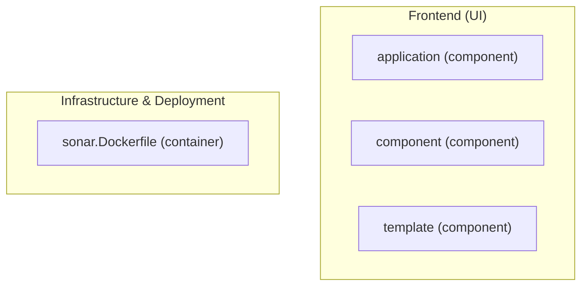

# Full-Stack Migration Inventory: penalite-frontend

## Architectural Domains Detected

- **frontend**
- **infrastructure**

## Layer Summary

| Domain | Node Count |
| --- | ---: |
| frontend | 3 |
| backend_api | 0 |
| database_schema | 0 |
| infrastructure | 1 |
| **Total Edges** | **0** |

## Discovered Components & Endpoints

| Node ID | Domain | Entity Type | Path | Line |
| --- | --- | --- | --- | ---: |
| `frontend:application` | frontend | component | `app/templates/application.hbs` | - |
| `frontend:component` | frontend | component | `app/features/components/suivre-taux-service-cql-parent/taux-service-cql/component.js` | - |
| `frontend:template` | frontend | component | `app/features/suivre-taux-service-cql/template.hbs` | - |
| `infra:dockerfile:docker` | infrastructure | container | `docker/sonar.Dockerfile` | - |

## Cross-Domain Dependencies

_No cross-domain edges identified._

## Dependency Graph (Mermaid)

